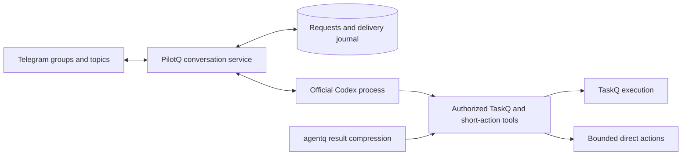

# Minimal PilotQ core with Codex subscription access

Research date: 2026-10-16. Governing contract: [pilotq.md](../pilotq.md), especially R1–R9. This is an architecture proposal, not a deployment decision. Only the owner's Codex-only, subscription-only requirement has been added as a requirement. Claude and separately billed model APIs are excluded.

## Recommendation

Build PilotQ's small service layer and qualify an official Codex process as its only manager engine. Prefer Codex app-server over a full Pi coding-agent dependency for the conversational integration. Do not put Pi's agent loop around Codex's agent loop. Keep TaskQ responsible for long execution.

This minimizes new provider and agent machinery to maintain. It does not minimize the total number of lines shipped in dependencies: Codex is a substantial runtime. PilotQ must keep ownership of accepted requests, authorization, external effects and delivery so that runtime changes do not become changes to the product's reliability contract.

An entirely owned model/tool loop remains technically possible through supported ChatGPT plan inference, but it means taking ownership of auth lifecycle, request compatibility, tool protocol, history and compaction. Given the owner's Codex-only direction, that work needs a demonstrated benefit before being added.

## What Pi actually supplies

Pi 1.3.0 is layered; adopting the coding agent is not required to use its lower libraries. Source pin: `71023aec1546d6d677a65669c5665c0927ce0dd0`.

| Layer | Work it supplies | Work still owned by PilotQ |
|---|---|---|
| `pi-coding-agent` | Agent sessions, coding tools, extensions, compaction, SDK/RPC and interactive surfaces | Telegram routing, durable acceptance, grants, effect reconciliation and delivery |
| `pi-agent-core` | Model/tool loop, events, validation, cancellation, steering and context hooks | Persistent request state, restart policy, effect journal, context persistence and compaction policy |
| `pi-ai` | Provider protocols, streaming, model catalogs, OAuth and credential refresh abstractions | A tool loop, durable credential store, app identity, conversation lifecycle and all product behavior |

The installed manifests contain 22, 2 and 10 direct dependencies respectively. These counts describe package scope, not failure rates; importing fewer providers does not remove all installation dependencies. `pi-agent-core` depends on `pi-ai`, which itself includes several provider SDKs.

The [core README](https://github.com/earendil-works/pi/blob/71023aec1546d6d677a65669c5665c0927ce0dd0/packages/agent/README.md) exposes `prepareRequest` for canonical context and `finishTurn` for finalized outcomes. Its inspected `Agent` transcript and steering queues are memory-backed. These hooks enable a durable host; they do not supply PilotQ's input/effect/outbox transaction. Parallel tool execution is the default, although sequential execution is configurable.

The [provider README](https://github.com/earendil-works/pi/blob/71023aec1546d6d677a65669c5665c0927ce0dd0/packages/ai/README.md) and [ChatGPT OAuth implementation](https://github.com/earendil-works/pi/blob/71023aec1546d6d677a65669c5665c0927ce0dd0/packages/ai/src/auth/oauth/openai-chatgpt.ts) include the newer Sign in with ChatGPT route. This gives `pi-ai` real value for an owned loop; it is not a necessary intermediary for official Codex. A PilotQ integration would still need its own durable credential storage and correct host/app identity.

Pi's reported coding-agent transport and compaction issues in [earlier research](research.md#user-reports-converted-into-acceptance-cases) are reasons for tests, not proof that every Pi layer has those defects. There is no measured reliability ranking for these PilotQ alternatives.

## Alternatives under the current requirement

| Integration | Benefit | Maintenance and limitation | Assessment |
|---|---|---|---|
| PilotQ + Codex app-server | Native auth support, threads/resume, terminal events, interrupt and MCP | Substantial external runtime; configuration, context boundaries and protocol version need qualification | First prototype candidate |
| PilotQ + `codex exec --json` and resume | Simple child process lifecycle; TaskQ already uses this pattern | Less convenient live session control; still runs the Codex loop and compaction | Compare only if app-server complexity is material |
| Owned loop + `pi-ai` | Own context and scheduling; reuse provider protocol and subscription integration | Own history/tool loop, persistence and compaction; extra multi-provider surface | Reserve for an identified app-server blocker |
| Owned coordinator + `pi-agent-core` and `pi-ai` | Reuse loop/events/context hooks without the full coding agent | Must reconcile two scheduling/state layers; auth eligibility unchanged | Possible, but no demonstrated need for the current scope |
| Full Pi coding agent | Fast route to a customizable coding assistant | Much of its session, coding and extension behavior is outside the manager's job | Do not make it the default |
| Owned loop + direct supported subscription protocol | Maximum control and fewer agent dependencies | Highest ownership of auth, streaming, tool history, compatibility and compaction | Do not start here merely to reduce package count |

The local TaskQ `src/runtime.rs` launches `codex exec --json` and `exec resume`; it is not an existing app-server adapter. Reuse its process-lifecycle lessons without presenting worker-launch code as a ready Telegram manager.

## Subscription access has its own boundary

The requirement concerns subscription entitlement rather than the network protocol: a supported subscription path can call an endpoint named Responses API without using separately billed API-key access.

[Codex app-server documentation](https://developers.openai.com/codex/app-server) describes managed ChatGPT sign-in, with Codex persisting and refreshing credentials. It also states that existing local/open-source integrations can continue, while commercial or hosted services need the appropriate Sign in with ChatGPT path. This research does not establish that PilotQ's private, shared FRA deployment qualifies automatically.

[Sign in with ChatGPT](https://developers.openai.com/siwc/token-sharing-open-source) documents plan-backed inference for open-source and locally hosted apps. It also documents [self-hosted VMs](https://developers.openai.com/siwc/token-sharing-open-source/self-hosted-vms), while directing paid or remotely hosted app providers to an interest process. A personal VM example does not settle entitlement for a shared Telegram service or pooling one account across people. Resolve account/workspace ownership and the applicable deployment route before production; Pi cannot remove this dependency.

The [preview limitations](https://developers.openai.com/siwc/token-sharing-open-source/preview-limitations) require streamed, non-stored responses and explicit request history over HTTP. The [app-server SIWC setup](https://developers.openai.com/siwc/token-sharing-open-source/codex-app-server) gives the host responsibility for token refresh and restarting app-server with renewed credentials before resuming its thread. This differs from Codex-managed login. Do not promise automatic refresh for every auth mode.

Proposed PilotQ behavior on exhausted limits or expired auth: retain the request, expose the cause and retry/reauthentication condition, and keep deterministic status/stop controls available. Never use a separately billed key as a fallback. Remaining limits are an account dependency, not evidence of a broken conversation queue.

## The small service we should own

PilotQ persists input before Telegram acknowledgement, identifies route and sender, serializes each conversation and tracks the native Codex thread. It records plans and grants outside model summaries. It verifies tool authority and records effect intent/result, then persists the answer before delivery. A lost delivery never starts the task again.

Codex owns the inner model/tool conversation and native compaction. PilotQ owns the outer request deadline, cancellation, restart and reconciliation. There is one owner for each retry budget and one tool executor. A stream closing is not success: inspect `turn/completed` and its status. Do not release an ambiguous mutation for automatic replay.

Initial simplifications proposed for contract review: sequential tool effects, follow-ups queued until the current bounded turn finishes, one tool bridge, no mid-tool steering, no parallel runtime adapters, no automatic provider switching, no plugin discovery and no local sustained-goal scheduler. Keep ordinary planning and explicit execution via TaskQ. These proposals do not silently remove existing requirements or acceptance cases.

The [app-server protocol](https://developers.openai.com/codex/app-server) exposes custom `dynamicTools`, but that surface is experimental. Prefer a small local MCP tool bridge first. Its handlers enforce route/user/target authority; use explicit conversation binding rather than trusting model-supplied chat IDs. An MCP allowlist alone does not disable built-in tools. The [configuration reference](https://developers.openai.com/codex/config-reference) includes MCP tool allow/deny lists and `features.shell_tool`; qualify the complete model-visible surface on a pinned binary and enforce OS permissions around remaining capabilities. A prompt saying “manager only” is not containment.

Use an isolated Codex configuration and explicit neutral workspace. Import only reviewed instructions and tools. Pin the runtime and dependencies; updates enter through the same small scenario suite. Existing requests and TaskQ receipts must remain recoverable when the runtime changes.

## agentq integration

The current local [agentq contract](https://github.com/taskqorg/agentq/blob/8dad28826ea108115f673cdc7589f93d7119f882/agentq.md) already defines Codex integration through a loopback provider and original-result retrieval via MCP. This is a specification boundary, not proof of PilotQ integration.

There is a material scope detail: qualified Codex compression targets listed shell-tool results; other tools, including MCP results, pass through. A manager that mainly calls TaskQ through MCP must not be advertised as receiving that compression automatically. Add and qualify a narrow result adapter/recipe in agentq if its TaskQ outputs need compression. Preserve exact originals, access scope, errors and call/result association.

Prefer compression at the owned tool-result boundary when feasible; keep conversation summarization in Codex initially. Do not add a second conversation compactor. If full arbitrary pre-request context rewriting becomes necessary, record that as a reason to reconsider an owned loop. Codex app-server is not equivalent to Pi's unrestricted context hooks.

Compare agentq off/on for the same conversations and TaskQ tool results. Check preserved project changes, permissions, plan revision, pending questions and exact original recovery after resume and compaction. Use actual provider token/cache evidence where available; smaller bytes alone do not prove lower subscription consumption or better answers.

## Selection proof

Use the existing [acceptance cases](acceptance.md). A minimal isolated prototype should establish:

1. Subscription sign-in and renewal work for the selected account and deployment route; no API-key fallback occurs.
2. Two Telegram routes remain isolated, including users sharing a forum topic under its chosen policy.
3. Discussion, plan revision and explicit TaskQ submission preserve the actual author's authority.
4. Duplicate input, killed Codex, service restart and lost Telegram send response do not repeat external work.
5. A stalled response can be stopped; follow-up input remains queryable; rate-limit failures are visible.
6. Context resume/compaction and agentq original recovery preserve task links, prohibitions and outstanding questions.
7. Only intended tools can reach project resources; stale runtimes cannot dispatch new effects.

Do not implement multiple complete backends to compare them. Start with app-server and fake TaskQ tools, then one real held-task flow when authorized. Reconsider the loop only if a recorded blocker cannot be addressed through a small supported integration.

This research ran source/document inspection only. It did not log into a provider, consume model quota, send Telegram messages, activate TaskQ, change FRA, or establish long-run reliability. Provider entitlement for the shared deployment and end-to-end agentq behavior remain unqualified.
