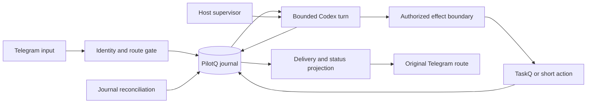

# Agent reliability mechanisms for PilotQ

Source review: 2026-10-16. Governing decisions: [pilotq.md](../pilotq.md), especially R5, R9–R11 and section 11. This research compares mechanisms, identifies specification gaps and maps them to acceptance. It does not rank measured uptime, adopt another agent, or claim that source code and upstream tests prove a working PilotQ.

## Scope and evidence

| Project and source pin | What its code is mainly for | Relevant boundary |
|---|---|---|
| Hermes v0.22.2, `d923a5eb487a17c0a68801bba9ef0f56c81040a8` | A complete assistant: model/tool execution, memory, sessions, platform gateways, background work and notifications | Many recovery mechanisms exist, but their interaction and persistence policies need qualification |
| Pi v1.3.0, `71023aec1546d6d677a65669c5665c0927ce0dd0` | A model/provider library, agent loop and coding-session harness | The core has no Telegram ingress or delivery contract; Pi Durable is a separate experimental harness |
| NanoClaw v2026.10.0 core, `7203e00dc271cc2ea9ea84bb130731b8ca00319e` | Container-isolated agents, per-session mailboxes and reconciliation between host and runners | The inspected core and optional channel code are separate; do not infer Telegram behavior from mailbox code alone |
| NanoClaw channels snapshot, `d2407fe3b4e30db69779567d945e72ee1b078028` | Optional channel integration, including Telegram through Chat SDK | An independently pinned branch, not proof that this exact combination was released or works with the core pin |
| Takopi v0.23.4, `e0123d4f9b2588bf45ec7250ad648c324e20ce20` | Telegram bridge to existing coding runtimes, with progress, cancellation and resume | Closest product boundary to PilotQ, but its persistence and startup policies differ from ours |

Hermes, NanoClaw core and Takopi release tags were checked against GitHub during this review. Pi uses the already inspected pinned 1.3.0 packages/source. The review read implementations, selected upstream tests and three issue reports; it ran none of the products or tests and made no model calls. OpenClaw is excluded from this pass at the owner's request. NanoClaw is not HKUDS/nanobot.

The [source ledger](#source-ledger) identifies the implementation behind every short evidence code. A code documents a mechanism or counterexample, not necessarily an implementation to copy. Coverage labels below describe the PilotQ specification before this pass: **Covered**, **Clarify**, **Gap**. **Decision** means owner selection is still needed. **Out** and **TaskQ** are explicit scope dispositions. All newly specified behavior remains unimplemented.

## Findings that change the design

**An agent runtime and a reliable messaging service solve different problems.** Pi validates tool arguments and manages continuation; that does not preserve a Telegram update. Takopi's progress model is useful even though its outbox is memory-backed. NanoClaw's mailboxes survive process restarts, but automatically requeueing a processing row is not proof that a previously executed external effect is safe to repeat. PilotQ must keep independent effect receipts.

**Hermes already contains substantial recovery logic.** Its stall policy uses an agent activity snapshot and a notify-once latch [H2]. A separate thread watchdog can still run when gateway asyncio is starved, including before the first activity event [H3]. Its delivery ledger distinguishes pending, attempting, delivered and failed, with honest recovered-reply markers [H4]. However, the ledger explicitly treats failures as best-effort and lets sends proceed. PilotQ's final-output contract requires the durable write to succeed before sending; adopting the same feature name would not preserve that stronger invariant.

**Takopi shows useful UI patterns and two unsuitable defaults.** Progress edits collapse intermediate events; outbound sends outrank edits and respect retry delays [T1][T2]. The inspected outbox and per-thread queue are in-memory [T1][T3]. Its startup path drains pending Telegram updates before entering the normal loop [T4]. That may fit a terminal bridge, but PilotQ must retain and reconcile accepted work and cannot intentionally discard its backlog on every restart.

**NanoClaw separates the agent process from delivery and reconciles durable state.** Mailboxes retain input/output, processing acknowledgements and routing [N1]; attempt counts survive host restart [N2]. Reconciliation checks heartbeat age and message claim age, including a process that never wrote its first heartbeat [N3]. Typing stops when heartbeat freshness expires [N4]. Its keyed reconcile queue reruns a key dirtied during an in-flight pass and backs off one key without blocking others [N5]. These patterns are useful; their container topology and numeric timeouts are not PilotQ requirements.

**A small branding claim does not imply a small current runtime.** The inspected NanoClaw release contains modules, permissions, task scheduling, container lifecycle and optional channel/provider branches. Its channels snapshot sets Telegram `supportsThreads: false` and defaults unknown senders to approval requests [N7]. Those defaults do not meet PilotQ's forum-topic and silent-ignore requirements. Telegram polling itself belongs to the downstream adapter and was not audited transitively in this pass.

**Pi has safety details worth preserving without adopting Pi.** Its core rejects tool calls from a response truncated at the output limit, even if salvaged arguments parse, validates arguments, supports before/after hooks and cancellation [P1]. Coding-agent adds retries, compaction and a settled event beyond a single message ending [P2]. Native session writes are not an atomic transaction with Telegram or TaskQ [P3]. Pi Durable makes replay policy explicit, including external idempotency requirements, but labels its API experimental [P4]. PilotQ needs the invariants, not another durable execution engine beside TaskQ.

## Mechanism matrix

Implementation owners are **PilotQ**, **Codex**, **TaskQ**, **agentq**, or the existing **host supervisor**. Case IDs link by name to [acceptance.md](acceptance.md). Minimal implementations below are proposals governed by the root contract, not independent mandates.

### Input and identity

| ID | Mechanism | Disposition | Minimal PilotQ implementation and owner | Evidence | Acceptance |
|---|---|---|---|---|---|
| M01 | Commit before acknowledging input; duplicates | Covered, required | PilotQ transaction holds admitted input/ignored disposition and polling cursor; stable update identity | [H1], [N1] | F01, F02 |
| M02 | Unknown-user gate and editable identities | Covered, required | PilotQ checks numeric user ID and grants before any model/context/command handling | [H6], [N6] | U17, U18, F15–F17 |
| M03 | DM/group/topic/reply identity | Covered, required | PilotQ route includes bot/chat/topic and configured person/shared scope; preserve author | [H5], [T5], [N7] | U02, F09, L13 |
| M04 | Bot capability and privacy readiness | Gap, required | Check actual bot identity, route permissions and topic capability; distinguish inability to observe traffic from idle chat | [H7], [N7] | L10, L13 |
| M05 | Edited/deleted input after authorization | Covered, required | PilotQ revisions; edits cannot rewrite approved plan or completed effect | [T4], contract §2/4 | U14, L14 |
| M06 | Bursts, albums and text after an attachment | Clarify, required | Preserve each update, then bounded same-author/same-route assembly; no cross-user concatenation | [T4] | L14 |
| M07 | Oversize/unsupported/unauthorized input | Clarify, required | Apply byte/media limits before expensive processing; unknown users stay silent; admitted unsupported input gets a result | [H6], [T4] | F12, F15, U14, L19 |
| M08 | Backlog after startup or outage | Clarify, required | Reconcile persisted inputs and poll cursor; never use a discard-backlog startup loop; report Telegram retention gaps | [T4] counterexample | F01, F13, L15 |

### Conversations and context

| ID | Mechanism | Disposition | Minimal PilotQ implementation and owner | Evidence | Acceptance |
|---|---|---|---|---|---|
| M09 | One active turn per conversation | Covered, required | PilotQ schedules durable requests; Codex owns one inner turn; no two independent steering queues | [H1], [T3], [P1] | U12, C04 |
| M10 | Fairness, bounded concurrency and backpressure | Covered, required | PilotQ limits route/global backlog and active runs; one slow route does not block others | [H1], [N5] | F12, L19 |
| M11 | Stop/status outside the model backlog | Gap, required | Bounded authorized control lane; cancel one correlated run or queued request | [T2], [T3] | U16, L06 |
| M12 | Native-session binding and reset generation | Clarify, required | Persist Codex thread/account/route mapping and generation; reject stale events after reset | [H5], [H8], [T5] | C06, L06, L09 |
| M13 | Missing/corrupt native history | Covered, required | Preserve broken evidence; explicit rebuild from journal and receipts, never silent fresh session | [P3], [H5] | F08, C06 |
| M14 | Compaction and overflow | Clarify, required | Codex owns conversation compaction; serialize with input and bound recovery; no no-progress retry loop | [P2] | C01, C03, C04, L05 |
| M15 | Per-person facts, corrections and privacy | Covered, required | PilotQ versioned scoped profiles independent of lossy summaries and grants | [N6], contract §6 | U17, C05, C07 |
| M16 | Large tool results and original recovery | Covered, required | agentq at a qualified result boundary; preserve call IDs/errors/original refs; TaskQ facts read fresh | [P1], [A1] | C02, C03, C05 |

### Runtime and external effects

| ID | Mechanism | Disposition | Minimal PilotQ implementation and owner | Evidence | Acceptance |
|---|---|---|---|---|---|
| M17 | Incomplete/malformed tool calls | Gap, required | Codex adapter exposes only complete validated calls; PilotQ validates argument/target boundary before effects | [P1] | L07 |
| M18 | Authority checked when an effect happens | Covered, required | PilotQ tool handlers recheck user, route, project, grant and plan revision | [N6], [H8] | F09, F10, F17 |
| M19 | Crash between effect and local receipt | Covered, required | PilotQ intent/outcome journal; same TaskQ operation ID; unknown non-idempotent effects never replay blindly | [P4], [N3] limitation | F04, U04, U15 |
| M20 | Result provenance versus model claims | Covered, required | TaskQ/target evidence owns completion; model prose only summarizes it | [H8], [K1] | U06, U07, F03 |
| M21 | EOF, empty answer and terminal status | Clarify, required | Adapter requires native terminal status and useful answer/delegation/effect outcome; EOF is not success | [T2], [P2], [K1] | F03, L07 |
| M22 | Cancel and process-tree cleanup | Clarify, required | PilotQ requests interrupt, fences generation, then host-scoped process-group termination; reconcile effects | [T6], [H3] | U12, L06, L15 |
| M23 | Startup/first-event and inactivity watch | Gap, required | PilotQ watchdog starts before Codex; separate event-loop-independent host health | [H3], [N3] | L04, L18 |
| M24 | Absolute deadline despite chatter | Clarify, required | PilotQ deadline cannot be renewed by tokens/typing; bounded tool deadlines and explicit long-task delegation | [H3], [N3] | U11, L05, L17 |
| M25 | Retry classification and retry multiplication | Clarify, required | One persisted budget per operation; choose retry owner across Codex/adapter/service; no retry for unknown writes | [P2], [H4], [N3] | F03, F04, L08 |
| M26 | Quota/auth failure and renewal | Gap, required | Retain waiting request and account/thread binding; explicit reset/sign-in reason; no billed-key fallback | [K1], [K2] | L08, L09 |
| M27 | Runtime capability/version handshake | Gap, required | Validate pinned protocol/tool interface before execution; unknown control events cannot be treated as completion | [K1], [T7] | L07, L10, L20 |

### Feedback and delivery

| ID | Mechanism | Disposition | Minimal PilotQ implementation and owner | Evidence | Acceptance |
|---|---|---|---|---|---|
| M28 | Accepted/queued versus actually running | Clarify, required | PilotQ commits first, then sends a truthful acknowledgement/status projection | [T2], [T3] | L01 |
| M29 | Typing lifecycle | Gap, required | Best-effort scoped timer gated by current run/activity; stop on wait, stale activity, cancel or finish | [N4], [H7] | L02 |
| M30 | Meaningful progress without spam | Gap, required | Event-driven coalesced status edits; no periodic LLM reassurance or raw reasoning/log dumps | [T1], [T2], [H2] | L03 |
| M31 | Waiting/failure/uncertain outcome notices | Clarify, required | Durable incident or question with cause and next action; one notice per episode | [H2], [H4] | L01, L03, L08 |
| M32 | Verified recovery notice | Gap, required | Fresh poll/model/tool evidence closes the matching incident; does not claim the task finished | [H2], [H7] | L03, L18 |
| M33 | Late progress cannot overwrite final | Gap, required | Revision/generation fence on status edits; finality barrier in outbound projection | [T1], [T2], [H8] | L06, L12 |
| M34 | Final result and chunk receipts | Clarify, required | PilotQ persists final+outbox before send; stable ordered chunks, individual sent IDs and pending states | [H4], [N1], [N2] | F05, L11 |
| M35 | Flood limits and output priorities | Clarify, required | Honor retry-after; prefer final/question/failure over progress; preserve per-request chunk order | [T1], [H4] | F05, L11, L12 |
| M36 | Formatting failure and Unicode limits | Covered, required | Safe sink escaping, bounded splitting, plain-text fallback; reuse stored final text | [H9], [N7] | F05, L11 |
| M37 | Ambiguous Telegram send | Covered, required | Keep uncertainty; bounded at-least-once result delivery, honest duplicate possibility; never repeat tools | [H4], [N2] | F05, L11 |
| M38 | Closed topic, removed bot or migrated group | Clarify, required | Hold original destination; explicit administrative route migration, no wider fallback | [H4], [H8], [N7] | U14, L13 |

### TaskQ and operational lifecycle

| ID | Mechanism | Disposition | Minimal PilotQ implementation and owner | Evidence | Acceptance |
|---|---|---|---|---|---|
| M39 | Worker questions and stale buttons | Covered, required | TaskQ owns question revision/attempt; PilotQ verifies actor and answer target | [H8], contract §5 | U07, U08, F14 |
| M40 | Missed/duplicate TaskQ notifications | Clarify, required | Persist observed event identity/cursor; periodic fresh read reconciles missed wakeups | [N5], [H8] | F14, L16 |
| M41 | Health by ingress/dispatch/model/delivery | Clarify, required | Timestamped component observations; alive process and outbound success cannot mask deaf ingress | [H7], [N3] | F06, L18 |
| M42 | Heartbeat meaning | Clarify, required health only | Host/run heartbeat observes health; no heartbeat that launches autonomous model work | [H2], [H3], [N4] | L02, L04, L18 |
| M43 | Alert when PilotQ itself is dead | Covered, required | Existing external host monitor; in-bot reporting cannot cover its own total outage | [H3], contract §7 | L18 |
| M44 | Startup and periodic reconciliation | Gap, required | One PilotQ journal scanner; coalesced per-key wakeups, bounded retry; DB is authority, timers are not | [N3], [N5] | L16 |
| M45 | Graceful drain and orphaned children | Clarify, required | Stop dispatch, persist/fence, terminate manager descendants; leave TaskQ workers to TaskQ | [H10], [T6], [N8] | L15 |
| M46 | One consumer and lock ownership | Covered, required | OS-held local lock plus Telegram conflict diagnosis; no PID-only ownership proof | [T8] counterexample, [H4] | F02, F11 |
| M47 | Disk, DB contention, memory and file bounds | Clarify, required | Existing SQLite/storage limits plus bounded payloads/process output; fail admission honestly on commit failure | [N1], contract §7 | F08, F12, L19 |
| M48 | Schema compatibility, backup and restore | Covered, required | Preserve evidence; restore journal together with native mapping/receipts; reconcile remote effects | [P3], contract §9 | F08, F11, L20 |
| M49 | Update and rollback without dropped work | Gap, required | Follow specq release rules; qualify pinned PilotQ/Codex/config/schema set and drain before activation | [H10], [N8], [K1] | L15, L20 |
| M50 | Correlated diagnostics without secrets | Covered, required | Local request/run/tool/task/delivery correlation; sanitize user-visible errors and optional telemetry | [H2], [T2], contract §8 | L03, L19 |
| M51 | Alert storms and feedback loops | Gap, required | Incident dedup across restart, recovery evidence, bounded alert backlog; cosmetic failure does not spawn an agent | [H2], [T1], [H6] | L03, L18 |
| M52 | Model-visible tools and actual containment | Clarify, required | Explicit tool inventory plus OS boundary; no arbitrary native shell bypass hidden behind an MCP allowlist | [P1], [K1], [K3] | F09, L07, L10 |
| M53 | Discussed plan versus authority to run | Covered, required | PilotQ proposal revision and explicit execution scope; TaskQ receives verified held tasks | [T4] plan commands, contract §2/5 | U05, U06, U15 |
| M54 | Hermes cutover and rollback manifest | Covered, required | Preserve people, grants, route policy, project links and active work; one poller; no blind history/goal replay | [H5], [H8], contract §9 | F13, U02, U18 |

### Deliberate exclusions and open choices

| ID | Mechanism | Disposition | Minimal PilotQ implementation and owner | Evidence | Acceptance |
|---|---|---|---|---|---|
| M55 | Voice/image/file interpretation | Decision; detection/limits required | Preserve input identity and report unsupported content now; select interpretation parity from Hermes inventory before cutover | [T4], [H9] | U14, L14, L19 |
| M56 | Multi-provider/model fallback and credential pools | Out | One Codex subscription integration; quota/auth failure becomes explicit waiting/failure | [P5], R9 | L08, L09; dependency/config inventory |
| M57 | Autonomous goals, proactive model heartbeat and cron | TaskQ/existing scheduler | Manager discusses and delegates; PilotQ maintenance timers do not become a worker scheduler | [H11], [N1], R3 | U06, U10, U13; architecture review |
| M58 | Plugin marketplace, multi-agent teams and self-modifying bot | Out | Fixed reviewed tool surface; changes follow specq instead of runtime plugin discovery | [P2], [N8] | L10, L20; tool/config inventory |
| M59 | Multiple bots/channels, distributed HA and container-per-person | Out initially | One Linux host and bot; logical conversation isolation plus manager process containment | [N7], [N8] | F02, U02; deployment inventory |
| M60 | Own provider protocol, agent loop or second compactor | Out initially | Use Codex; revisit only a recorded integration blocker, with owner review | [P1]–[P5], [K1] | C01–C07; architecture review |

## What changed in the specification

The matrix contains 60 mechanism decisions, not 60 services or a promise to reimplement four agents. Previously under-specified areas are now proposed in [contract section 11](../pilotq.md#11-proposed-lifecycle-and-feedback-protocol): startup and independent activity clocks, typing/progress lifecycle, notification semantics, prioritized controls, stale-event fences, chunk-level delivery, subscription wait/renewal, capability readiness, lost-wakeup reconciliation and safe runtime lifecycle.

Twenty lifecycle cases L01–L20 extend the existing 42 functional/fault/context cases to 62 cases. They are scenario families with concrete fault points, not executed tests. A required mechanism cannot be accepted solely because the equivalent upstream module exists. The release report must map each required matrix row to results on the exact candidate, with unknowns visible. Out-of-scope rows receive configuration/dependency review rather than invented runtime tests.

## Simple implementation shape

Keep five implementation areas: Telegram admission, journal/state transitions, Codex process adapter, authorized TaskQ/short-action tools, and delivery/health reconciliation. These can live in one PilotQ service with an isolated Codex child; they do not imply five microservices, Redis, a broker or another workflow engine.

A task can succeed while delivery is pending; a connection can recover while its task remains uncertain. Those states must stay separate. Exactly-once external execution cannot be promised for an arbitrary non-idempotent tool. Telegram send ambiguity and updates older than its retention window remain protocol limits. The contract gives each a visible bounded outcome rather than hiding it behind retries.

## Qualification method

Use generated event sequences and fake clocks/transports to test the transition model first, following [specq verification](https://github.com/taskqorg/specq/blob/main/engineering/verification.md). For every boundary vary success, timeout, definite rejection, ambiguous completion, duplicate and stale/out-of-order event. Kill before and after durable commits and external effect/send acknowledgements. Add permission revocation, cancellation and restart at those same boundaries. This systematic cross-product catches interactions that a happy-path feature checklist misses.

Then qualify real Codex subscription auth, actual Telegram topics/delivery and TaskQ create/readback/ask/resume on isolated credentials and boards. Test power-loss storage claims separately from process SIGKILL; a mock transaction test does not establish disk/controller durability. Keep deterministic chain checks in the cheap suite; live and platform checks belong to release qualification. No live probes were run for this document.

Do not silently weaken a failed gate. Fix the integration or record an owner decision in the contract. Remaining design choices include direct-action grants, media parity, exact budgets, shared-server subscription entitlement, and service/artifact/schema ownership. This list is complete for the reviewed boundaries and stated requirements, not proof against every possible product defect.

## Source ledger

**Hermes:** [H1] Telegram admission receipts and per-chat FIFO; [H2] stall policy and [watcher](https://github.com/NousResearch/hermes-agent/blob/d923a5eb487a17c0a68801bba9ef0f56c81040a8/gateway/run_watchers.py); [H3] independent inactivity watchdog in `_watch_gateway_turn_inactivity`; [H4] delivery obligation states and best-effort policy; [H5] profile-scoped session recovery; [H6] ignore/pair split and bounded owner notices; [H7] Telegram polling-generation fencing, successful-poll versus dispatch accounting and typing cooldowns; [H8] ownership of delayed completions; [H9] final/stream formatting; [H10] shutdown/drain/restart; [H11] session-bound autonomous heartbeat admission.

Selected tests read: [stall policy](https://github.com/NousResearch/hermes-agent/blob/d923a5eb487a17c0a68801bba9ef0f56c81040a8/tests/gateway/test_session_stall_watchdog.py), [delivery ledger](https://github.com/NousResearch/hermes-agent/blob/d923a5eb487a17c0a68801bba9ef0f56c81040a8/tests/gateway/test_delivery_ledger.py), and [admission](https://github.com/NousResearch/hermes-agent/blob/d923a5eb487a17c0a68801bba9ef0f56c81040a8/tests/plugins/test_telegram_update_admission.py). Inspection is not a passing test run.

**NanoClaw:** [N1] mailbox schemas; [N2] delivery drain guard and persistent attempt accounting; [N3] pure stuck-decision function and reconciliation; [N4] heartbeat-gated typing; [N5] keyed queue and dirty-key rerun; [N6] user/group access decisions; [N7] optional Telegram wrapper and its explicit thread/default-access settings; [N8] host lifecycle. The Telegram wrapper delegates polling to `@chat-adapter/telegram`; no transitive polling-reliability claim is made here.

Selected tests read: [persistent delivery attempts](https://github.com/nanocoai/nanoclaw/blob/7203e00dc271cc2ea9ea84bb130731b8ca00319e/src/delivery-attempts-authority.test.ts), [reconcile queue](https://github.com/nanocoai/nanoclaw/blob/7203e00dc271cc2ea9ea84bb130731b8ca00319e/src/reconcile-queue.test.ts), [typing routes](https://github.com/nanocoai/nanoclaw/blob/7203e00dc271cc2ea9ea84bb130731b8ca00319e/src/modules/typing/index.test.ts), [host lifecycle](https://github.com/nanocoai/nanoclaw/blob/7203e00dc271cc2ea9ea84bb130731b8ca00319e/src/host-lifecycle.test.ts).

**Takopi:** [T1] memory-backed outbox, replacement of pending edits, priorities and retry-after; [T2] progress projection, cancellation and terminal outcome; [T3] per-thread in-memory scheduling; [T4] startup backlog draining, media grouping, controls and routing; [T5] session persistence; [T6] process-group TERM/KILL cleanup; [T7] Codex event translation; [T8] PID-based single-instance lock. Its [JSON writer](https://github.com/banteg/takopi/blob/e0123d4f9b2588bf45ec7250ad648c324e20ce20/src/takopi/utils/json_state.py) uses replace but the inspected function has no fsync; it is not PilotQ's power-loss acceptance contract. [Bridge tests](https://github.com/banteg/takopi/blob/e0123d4f9b2588bf45ec7250ad648c324e20ce20/tests/test_telegram_bridge.py) include progress controls, queued cancellation and same-thread scheduling.

**Pi:** [P1] core tool loop and truncation handling; [P2] coding-agent session retry/compaction/settlement; [P3] native JSONL session persistence; [P4] experimental Durable replay contract; [P5] provider/credential layer. Installed JavaScript for 1.3.0 was inspected alongside the previously pinned source/docs. Pi core is not a Telegram adapter.

**Codex and agentq:** [K1] app-server protocol and terminal events; [K2] subscription preview/auth lifecycle limits; [K3] runtime configuration and tool switches; [A1] current agentq contract, including qualified result compression boundaries. Their existing integration research is in [core options](core-options.md).

Issue status was refreshed on 2026-10-16: [Pi #4945](https://github.com/earendil-works/pi/issues/4945), [NanoClaw #3728](https://github.com/nanocoai/nanoclaw/issues/3728), and [Takopi #254](https://github.com/banteg/takopi/issues/254) were open. They motivate transport-stall and single-consumer cases, not a claim that every pinned version reproduces them. NanoClaw's report concerns a polling layer beyond the wrapper inspected here. The earlier version-specific qualifications in [research](research.md) still apply.

[H1]: https://github.com/NousResearch/hermes-agent/blob/d923a5eb487a17c0a68801bba9ef0f56c81040a8/plugins/platforms/telegram/update_admission.py
[H2]: https://github.com/NousResearch/hermes-agent/blob/d923a5eb487a17c0a68801bba9ef0f56c81040a8/gateway/session_stall.py
[H3]: https://github.com/NousResearch/hermes-agent/blob/d923a5eb487a17c0a68801bba9ef0f56c81040a8/gateway/run.py
[H4]: https://github.com/NousResearch/hermes-agent/blob/d923a5eb487a17c0a68801bba9ef0f56c81040a8/gateway/delivery_ledger.py
[H5]: https://github.com/NousResearch/hermes-agent/blob/d923a5eb487a17c0a68801bba9ef0f56c81040a8/gateway/session_recovery.py
[H6]: https://github.com/NousResearch/hermes-agent/blob/d923a5eb487a17c0a68801bba9ef0f56c81040a8/gateway/run_inbound_unauthorized.py
[H7]: https://github.com/NousResearch/hermes-agent/blob/d923a5eb487a17c0a68801bba9ef0f56c81040a8/plugins/platforms/telegram/adapter.py
[H8]: https://github.com/NousResearch/hermes-agent/blob/d923a5eb487a17c0a68801bba9ef0f56c81040a8/gateway/run_notifications_ownership.py
[H9]: https://github.com/NousResearch/hermes-agent/blob/d923a5eb487a17c0a68801bba9ef0f56c81040a8/gateway/stream_consumer_fences.py
[H10]: https://github.com/NousResearch/hermes-agent/blob/d923a5eb487a17c0a68801bba9ef0f56c81040a8/gateway/run_shutdown.py
[H11]: https://github.com/NousResearch/hermes-agent/blob/d923a5eb487a17c0a68801bba9ef0f56c81040a8/gateway/run_heartbeat_acceptance.py
[N1]: https://github.com/nanocoai/nanoclaw/blob/7203e00dc271cc2ea9ea84bb130731b8ca00319e/src/mailbox/sqlite/schema.ts
[N2]: https://github.com/nanocoai/nanoclaw/blob/7203e00dc271cc2ea9ea84bb130731b8ca00319e/src/delivery.ts
[N3]: https://github.com/nanocoai/nanoclaw/blob/7203e00dc271cc2ea9ea84bb130731b8ca00319e/src/reconcile-session.ts
[N4]: https://github.com/nanocoai/nanoclaw/blob/7203e00dc271cc2ea9ea84bb130731b8ca00319e/src/modules/typing/index.ts
[N5]: https://github.com/nanocoai/nanoclaw/blob/7203e00dc271cc2ea9ea84bb130731b8ca00319e/src/reconcile-queue.ts
[N6]: https://github.com/nanocoai/nanoclaw/blob/7203e00dc271cc2ea9ea84bb130731b8ca00319e/src/modules/permissions/access.ts
[N7]: https://github.com/nanocoai/nanoclaw/blob/d2407fe3b4e30db69779567d945e72ee1b078028/src/channels/telegram.ts
[N8]: https://github.com/nanocoai/nanoclaw/blob/7203e00dc271cc2ea9ea84bb130731b8ca00319e/src/host-lifecycle.ts
[T1]: https://github.com/banteg/takopi/blob/e0123d4f9b2588bf45ec7250ad648c324e20ce20/src/takopi/telegram/outbox.py
[T2]: https://github.com/banteg/takopi/blob/e0123d4f9b2588bf45ec7250ad648c324e20ce20/src/takopi/runner_bridge.py
[T3]: https://github.com/banteg/takopi/blob/e0123d4f9b2588bf45ec7250ad648c324e20ce20/src/takopi/scheduler.py
[T4]: https://github.com/banteg/takopi/blob/e0123d4f9b2588bf45ec7250ad648c324e20ce20/src/takopi/telegram/loop.py
[T5]: https://github.com/banteg/takopi/blob/e0123d4f9b2588bf45ec7250ad648c324e20ce20/src/takopi/telegram/chat_sessions.py
[T6]: https://github.com/banteg/takopi/blob/e0123d4f9b2588bf45ec7250ad648c324e20ce20/src/takopi/utils/subprocess.py
[T7]: https://github.com/banteg/takopi/blob/e0123d4f9b2588bf45ec7250ad648c324e20ce20/src/takopi/runners/codex.py
[T8]: https://github.com/banteg/takopi/blob/e0123d4f9b2588bf45ec7250ad648c324e20ce20/src/takopi/lockfile.py
[P1]: https://github.com/earendil-works/pi/blob/71023aec1546d6d677a65669c5665c0927ce0dd0/packages/agent/src/agent-loop.ts
[P2]: https://github.com/earendil-works/pi/blob/71023aec1546d6d677a65669c5665c0927ce0dd0/packages/coding-agent/src/core/agent-session.ts
[P3]: https://github.com/earendil-works/pi/blob/71023aec1546d6d677a65669c5665c0927ce0dd0/packages/coding-agent/src/core/session-manager.ts
[P4]: https://github.com/earendil-works/pi/blob/71023aec1546d6d677a65669c5665c0927ce0dd0/packages/durable/README.md
[P5]: https://github.com/earendil-works/pi/blob/71023aec1546d6d677a65669c5665c0927ce0dd0/packages/ai/README.md
[K1]: https://developers.openai.com/codex/app-server
[K2]: https://developers.openai.com/siwc/token-sharing-open-source/preview-limitations
[K3]: https://developers.openai.com/codex/config-reference
[A1]: https://github.com/taskqorg/agentq/blob/8dad28826ea108115f673cdc7589f93d7119f882/agentq.md
