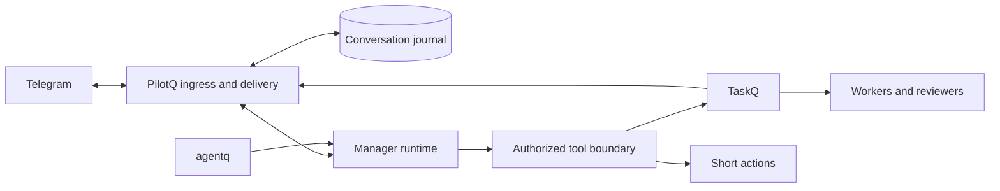

# PilotQ runtime and storage specification

Binding detail of [pilotq.md](../pilotq.md). Mandatory clauses retain their force; **Proposed**
clauses remain unqualified design targets, not shipped guarantees or deployment permission.

## 3. Architecture and ownership

PilotQ is one small Rust service in the TaskQ tool family.

| Part | Choice | Reason |
|---|---|---|
| Language and packaging | Rust single binary on [coreq](https://github.com/taskqorg/coreq) | Same release, update, service, status, selftest and incident path as taskq, agentq and dashq (R14) |
| Telegram | [teloxide](https://github.com/teloxide/teloxide) for the Bot API only | Maintained Rust library; PilotQ keeps its own durable ingress and outbox (section 4) |
| Telegram behavior | Patterns adapted from the Hermes gateway: update intake, delivery retry, stall watch, topic routing | Already exercised on our server (R12); read as reference, no change to Hermes |
| Manager runtime | Codex `app-server` under the subscription login, one adapter | R9; [core options](core-options.md) |
| Journal | SQLite (section 7 settings) | One local file, supported snapshot backup |
| Work execution | Existing TaskQ CLI | Section 5 |
| Voice recognition | ffmpeg and `sherpa-onnx-offline` with GigaAM v3 RNNT-punct int8, local CPU subprocesses | Best Russian accuracy per CPU in the #89 benchmark; keeps the static PilotQ build free of onnxruntime |

Grammy, Pi and a new runtime framework are out of scope. Earlier source findings remain in
[research](research.md).

| State | Authority | PilotQ responsibility |
|---|---|---|
| Received inputs, response delivery, route policy, grants and request correlation | PilotQ journal | Commit, deduplicate, restore and expose failures |
| Model conversation and summaries | Runtime session, backed by recoverable PilotQ input and finalized-output records | Preserve session identity; rebuild explicitly if native state is unusable |
| Plans being discussed | Versioned PilotQ proposal | Track target, author and authorization scope |
| Admitted task state, attempts, questions, dependencies and completion | TaskQ trusted board log | Read and invoke supported commands; cache only with source time |
| Project roots and worker capacity | TaskQ registration and host policy | Use registered entries; register a new project only on an administrator request (section 5); no directory discovery or silent enrollment |
| Compressed tool output and recovery reference | agentq adapter plus retained original evidence | Preserve access scope and validate recovered content |

Keep the runtime interface small: open/resume by ID, submit, stream events, interrupt, observe
terminal result and close. Implement one adapter first. Do not build a universal runtime framework.
The #190 owner decision enables native shell, network, live web search and full filesystem access as the service user; typed tools retain their validation.

The manager uses a neutral explicit workspace. Project context is resolved through the approved
registry and scoped tools, avoiding a process-wide current-directory switch shared by conversations.
Separate runtime processes are fault boundaries; native tools inherit the service user’s OS permissions.
The trusted-manager exception in pilotq.md §5 does not claim resource isolation from that user.

## 4. Durable conversation and effects

**Proposed invariant:** every durably accepted request is queryable as queued, running, waiting for
a person, delegated, answered, failed, cancelled or uncertain. Completion and Telegram delivery are
separate fields. No persistent state is inferred from a typing indicator or model prose.

### Ingress

Use long polling initially. Commit admitted inputs, minimal ignored-update dispositions,
deduplication keys and the next polling cursor in one SQLite transaction before making a Telegram
request that confirms those updates. A handler cannot advance the cursor past an uncommitted
disposition. A duplicate admitted update produces the existing request, not a second turn or task;
ignored updates remain ignored.

Use one OS-held polling lock per bot installation; PID text alone is insufficient. The supported
deployment is one host per token. A Telegram conflict from a second host is an incident, not an
endless retry loop. Deployment explicitly stops the old consumer before activating a new one.

Treat update IDs as protocol identifiers, not proof of uninterrupted human history. Telegram retains
undelivered updates for at most 24 hours; after a longer outage report the possible gap. Do not
claim that a new bot can fetch all old group history.

Edited messages create a revision. They can revise an unstarted proposal; they cannot silently alter
already authorized work. If work started, present the edit as a change request. A deleted input does
not revoke an already executed side effect.

### Runs and tools

Persist request and run identity before invoking a runtime. Require a native terminal outcome; a
closed stream or an empty response is not success. A generation/fencing token prevents a replaced or
aborted runtime from emitting new authorized tool calls or final replies.

Persist the intent and stable operation ID before each external effect; persist its outcome and
readback after it. A crash can occur between these steps. Recovery rules are:

| Interrupted operation | Recovery |
|---|---|
| Interrupted manager turn | Deliver recorded findings and unfinished work; do not replay |
| TaskQ mutation | Reconcile the same operation ID and revision against TaskQ |
| Direct idempotent mutation | Read back the target, then retry only under its declared idempotency contract |
| Non-idempotent or unobservable external effect | Mark uncertain, block automatic replay and request a decision |
| Completed result with pending Telegram delivery | Retry delivery; do not rerun the agent or tools |

SQLite records are the durable acceptance boundary. Pi's native JSONL session is not sufficient
evidence of power-loss durability or atomic external effects. Preserve a recoverable transcript
projection and tool receipts before acknowledging completion. Rebuilding a damaged native session
must not replay previous mutations.

### Delivery

Commit final replies, worker questions and results to an outbox with immutable destination and
correlation ID. Preserve per-conversation order; coalesce superseded progress updates only. Keep
terminal outcomes and unanswered questions.

Record Telegram message IDs after successful sends; update a known status message when useful.
Telegram `sendMessage` has no general client idempotency key: after a lost send response, a
duplicate visible reply is possible. Report an ambiguous send as such and use bounded at-least-once
delivery for results. Never repeat task execution to solve a delivery problem.

Normal accepted text uses an 👀 reaction within five seconds, without a text acknowledgement. If the
reaction fails, send a short text receipt. If an unstarted request waits over 30 seconds, send one
“Queued behind N” notice with the observed number of earlier requests in its conversation. Busy,
unsupported-input and recovery-control replies remain text. Keep the first-use retention notice as a
separate message once per person. No Telegram reply exposes internal request numbers, including
controls, failures and limits; IDs remain available through the operator CLI and audit records.

Private-chat answers do not quote the latest user message. Groups and topics retain reply
correlation, typing and edited task status messages. While generating in a private chat, stream
user-visible answer text through sendRichMessageDraft, falling back to sendMessageDraft. Coalesce
updates to at most one per second; drafts are ephemeral, fenced to the active run, and failures
never change the request outcome or replace final delivery.

Final answers first use sendRichMessage for content within 32768 UTF-16 units. On an explicit
unsupported-method or content rejection, fall back to HTML sendMessage in stable ordered chunks of
at most 4096 UTF-16 units, then plain text on entity errors. Preserve literal source content, escape
generated HTML at the output boundary and never allow raw model HTML to become markup. Persist
fallback chunks and individual receipts before sending; retries after an ambiguous rich send stay on
that same delivery method. A draft is never a final receipt. On upgrade, native sessions with the
older fixed tool catalogue rebuild explicitly from the recorded conversation and receipts before
receiving the new tools; completed effects are never replayed. Split oversized replies safely; do
not rerun generation. Reaction, draft, typing and final sends share a persisted per-chat cooldown
after Telegram rate limits; no fallback bypasses retry_after. Respect server retry delays, bound
retry counts and retain exhausted deliveries for operator recovery. Forbidden or missing-chat errors
must not reroute private results to a broader group or silently mark them delivered.

## 6. Memory and agentq

**Proposed:** conversation history, remembered preferences and authoritative task facts are
distinct. Store route/project preferences with author, scope, source and update time. “Usually this
project” is a hint; tool invocation still resolves the target. Explicit corrections supersede old
preferences. Shared memory never includes private conversation content without authorization.

Maintain durable per-person profiles for preferred name, relevant working preferences and explicitly
remembered project associations. Each fact carries its subject user ID, visibility scope, source and
revision. Load only facts permitted in the current route; remembering one person across chats does
not copy private DM history into a group. Profiles survive restart and conversation reset.

Provide a Telegram flow to inspect, correct and forget remembered facts. Users can manage their own
non-authoritative preferences; administrators can correct shared profile information within their
grant. Administration does not implicitly reveal another person's private DM memory. Show the
applied change and persist it before claiming success. Corrected or forgotten facts must not
reappear as current facts from an old summary, restored session or automatic extraction. Profile
deletion and correction are distinct from retention of conversation/audit records; do not claim that
forgetting a preference erases every historical record. Access rights live in the grant registry and
cannot be changed by editing a profile.

Keep these outside lossy summaries: identities and roles, grants and revocations, active project
references, request/operation IDs, task URLs, pending questions, plan revisions, explicit
prohibitions and verified effect receipts. Fresh TaskQ reads supply task state.

Start with native runtime compaction as the functional baseline. Integrate agentq at the selected
runtime's supported tool-result/context boundary. Tool-result compression and conversation
summarization are separate stages with one owner each; never let two compactors race or compress the
same result repeatedly.

Compression preserves tool-call/result associations, errors, evidence locations and original-data
recovery references. Recovery authorizes the requesting route before returning content. On
compression failure, use original data only if it fits the context budget; otherwise fetch a bounded
relevant portion or surface a context limit. Never silently truncate authorization or replay work to
reconstruct a missing result.

Qualification compares identical scenario sets with agentq off and on. Measure correct completion,
preserved constraints, exact original recovery, provider input/output/cache tokens where available,
latency and interventions. Byte reduction alone is not a savings claim. A session that survives one
compression is not evidence of a long conversation remaining correct.

## 7. Proposed operating budgets

These are initial acceptance targets, not observed performance or a production SLA. Tune only from
recorded pilot evidence.

| Concern | Initial target |
|---|---|
| Durable receipt | p95 <= 2 seconds from update receipt at PilotQ, under the defined pilot load |
| Telegram acknowledgement | 👀 reaction within 5 seconds when Telegram is reachable; text fallback on reaction failure, one queue notice after 30 seconds |
| Direct action | No fixed turn duration or tool-call cap; task work uses TaskQ first |
| Silent runtime | Ten minutes without a runtime event cancels with the exact reason; progress timers do not renew activity |
| Cancellation | Acknowledge within 5 seconds when transport is healthy; abort then terminate the isolated process after a 5-second grace period if necessary |
| Runtime recovery | Reconcile interrupted requests within 30 seconds after service readiness; uncertain effects stay blocked |
| Model concurrency | 4 conversations initially, one active run per conversation; round-robin waiting routes |
| Backlog | 50 pending requests per route, 1,000 total; excess gets a recorded busy response, never an untracked promise |
| Dependency retry | At most 3 safe model/read attempts within the original deadline; no retry multiplication across SDK and coordinator |
| Delivery retry | At most 5 attempts per episode, persisted across restart; obey Telegram retry delays, then surface pending delivery |
| Task notifications | Within 15 seconds of observing a fresh TaskQ transition, while Telegram is reachable |
| Health | Separate last successful poll, storage commit, model event, TaskQ observation and delivery; expose age and unknown state |

Storage: SQLite WAL with `synchronous=FULL`, one writer, local disk and bounded transactions. A
healthy process is not evidence of a healthy ingress path. Run liveness checks outside the model
process; use the existing host monitoring path for an outage that prevents Telegram alerts.

Proposed retention: raw conversations 30 days; request audit records (section 8) 365 days for
metadata and 90 days for message text; inactive native session files 30 days; request/effect
receipts 90 days after reconciliation; diagnostic logs 7 days; temporary attachments 7 days with a
20 MiB per-file cap. Keep active plans, unresolved effects, unanswered questions and undelivered
outcomes until resolved. Keep minimal deduplication/receipt tombstones beyond content pruning where
replay remains possible.

Initial PilotQ disk budget: 2 GiB including its journals, sessions and temporary files. At 80%,
prune only eligible data and alert. At the hard limit, preserve unresolved records, stop new
admission and report pressure through the host channel. Do not advance the Telegram cursor for an
input that could not be stored. This limit can cause a Telegram retention gap during a prolonged
outage; report it. Back up with SQLite's supported snapshot mechanism; prove restoration separately.

## 8. Access and observability

**Proposed:** configure explicit Telegram users/routes and action grants. Reading a group or a task
does not grant permission to mutate a project. Revalidate authorization at effect dispatch and
before delayed delivery. Revocation cancels pending unauthorized effects but cannot erase an already
completed operation.

Keep credentials in protected host configuration, outside model context and diagnostics. The manager
receives only tools granted to its caller and route.

### Key store

**Proposed:** a key is a named secret in one owner-only file under the install directory (mode 0600
or the Windows equivalent). Each key records its name, purpose, allowed tools, allowed users or
routes and last use; the value is stored once and never returned.

- A tool call names a key; the tool boundary injects the value into the child process environment or
  request header at dispatch.
- The value never enters model context, the journal, telemetry, logs, replies or task text. Tool
  output is scrubbed for known values before the model or Telegram sees it.
- A grant on a key names the person, route or project. Use is checked at dispatch, like any effect
  (section 8).
- Keys are added, granted and revoked only through the CLI (owner decision 2026-10-23). Telegram key
  entry is not built.
- `pilotq keys list` shows names, grants and last use, never values. A model's tool choice is a
  request, not enforcement. Downloaded content cannot expand grants, switch repositories or redirect
  private answers.

### Request audit

**Proposed:** the journal keeps one audit record per request from the CLI or Telegram (R17). It is
written in the same transaction as the admitted input and updated as the request moves.

- Who: person ID, display name at that time and the grant set used. When: receive, start, each
  effect and delivery times. Where: front end, chat, topic and project.
- What: the request text, its edits and cancellations, and the reply sent. Key values never appear
  (section 8 Key store).
- Done: model, version and agentq mode; each tool call and effect with its target and result; TaskQ
  tasks filed, answered or followed; the final outcome or failure.
- One request ID joins the audit record, the CoreQ telemetry trace and TaskQ task text, so an
  investigation can move from a Telegram message to a task attempt and back.
- Readers: the owner and administrators with an `audit` grant read all records through `pilotq
  audit`; every person can read their own with `/audit` in a direct message, answered without the
  model like the section 2 controls. In a group or topic `/audit` shows nothing, since it would
  expose one person's history to the others. Reading is itself recorded.
- Use: service investigation, answers to a person about their history, and self-improvement
  analysis. Analysis exports leave out message text unless the owner approves a specific export.
- The person learns at admission that their requests are recorded and for how long.

Local correlated events cover update → request → model turn → tool operation → TaskQ task/attempt →
Telegram delivery. The runtime adapter reports actual completion/error events.
Model/provider/version and agentq mode accompany evaluation evidence.

Use the existing Langfuse installation for optional, bounded telemetry export after capture scope is
approved. Content capture is opt-in and redacted; operational metadata is enough for delivery and
intervention metrics. Langfuse failure must not block conversations or become the only copy of a
task outcome. The proposed metric set lives in [acceptance](acceptance.md#metrics).

## 12. Proposed lifecycle and feedback protocol

This section translates R5 and R11 into a proposed PilotQ protocol. The [mechanism
matrix](mechanism-matrix.md) records source evidence and scope choices;
[acceptance](acceptance.md#lifecycle-cases) defines the additional checks. These are design
targets, not implemented guarantees. Notification presentation follows
[specq](https://github.com/taskqorg/specq/blob/main/caveman/rules/notifications.md).

### One request, separate observations

Keep the request state from section 4; use a reason/phase field for queued capacity, model startup,
tool execution, compaction, provider backoff, quota exhaustion or required login. Do not introduce a
second task state machine. Waiting for a person or for TaskQ is not a hung manager run. A delegated
request remains linked to the authoritative TaskQ task and its notification subscription.

Track transport health, request activity and delivery separately. A successful empty poll proves
transport contact; it does not prove received inputs reached admission. A live process or typing
indicator proves neither useful progress nor task completion. Count accepted/dispatched inputs and
pending age as well as successful polls. Unknown observation remains unknown.

The runtime supervisor cancels after ten minutes without a Codex event, including before the first event. Runtime events renew this monotonic inactivity clock; typing, polling and progress timers do not. There is no fixed total turn duration or tool-call cap. `/stop` fences the run and terminates its process group. One durable topic progress message is updated at most every thirty seconds while running. A restart ends an interrupted turn without replay: deliver recorded completed findings and explicitly identify unfinished or unconfirmed work, including agent-caused restarts (R5, R11). Native shell effects without recorded completion remain unconfirmed.

### Telegram feedback

Contract detail: [Telegram feedback](telegram-feedback.md) holds the owner decisions on manager
instructions, worker questions, reply layout, reactions, drafts, images and voice. It is binding as
part of this section.

### Input and control edges

During startup, check bot identity, required Telegram permissions/privacy configuration and
forum-topic support against the migration manifest. Do not report readiness solely from login
success. Received but unsupported inputs get the explicit outcome in section 1; unknown senders
still follow R10's silent policy.

Preserve message/reply IDs, edits and media-group identities before optional batching. Never
coalesce messages across users, routes or authorization revisions. A bounded media assembly window
cannot swallow a text follow-up or change a running plan. Recognizing attachments and reporting
limits are required; interpreting every media type remains an open cutover decision.

Authorized `/status`, `/stop` and `/new` use a bounded control path outside the normal model
backlog. They do not bypass identity or scope checks. A reset creates a new conversation generation;
old requests and receipts remain queryable, and late old-run events cannot attach to the new
conversation. Reset does not revoke the originating subscriptions to already admitted TaskQ work.

Topic deletion/closure, group migration, bot removal and permission loss become explicit
delivery/configuration incidents. Preserve the original destination and hold affected output. An
administrator must authorize a route change; do not fall back to General, a private DM or another
group automatically.

### Runtime and recovery boundaries

Validate the pinned Codex protocol/capabilities before accepting executable work. Unknown optional
diagnostic events can be retained as metadata; unknown control/terminal semantics cannot be guessed
as success. Parse tools only after a complete validated request; a parseable partial argument stream
is not permission to act. Native effects use service-user permissions and are not automatically replayed. An
empty useful answer with no verified delegation/action is an explicit outcome to recover or report,
not silent success.

Classify auth, quota, transport, protocol and tool failures. Keep one bounded retry budget per
logical operation across layers/restarts; honor server retry times without holding conversation
locks or spinning. Persist account/workspace binding with the native session. Reauthentication must
not silently change that binding, discard the session or fall back to billed API access. The shared
deployment's subscription entitlement remains a separate pre-production qualification.

Use one journal reconciler at startup and on a bounded periodic scan to discover pending inputs,
stale runs, uncertain effects, missed TaskQ events and undelivered outcomes. Timers are wakeups,
never the sole copy of work. Reconcile one request at a time; a failing route cannot stop recovery
for the others. Keep external calls outside database transactions.

On planned restart/update, stop new execution, checkpoint/drain within a bounded grace period, fence
and terminate remaining manager process trees, and leave unresolved work in the journal. TaskQ
workers retain their own lifecycle. Startup validates config and storage, obtains the poller lock,
reconciles state and only then reports readiness. A crash-loop backoff prevents repeated startup
from consuming retries or producing alert storms. An external host monitor handles a dead or blocked
PilotQ process; PilotQ cannot promise a Telegram notice while both it and Telegram are unavailable.

Apply the shared [release/service
contract](https://github.com/taskqorg/specq/blob/main/engineering/release-contract.md) to the
selected Linux service and pinned Codex artifact. Before implementation, name the service owner,
artifact/update source and compatible schema range. A rollback must preserve accepted work; an
incompatible database prevents unsafe downgrade. No live runtime replacement occurs mid-turn without
the drain/reconcile path.

This specification does not authorize installation, model calls, queue activation or replacement of
the production Telegram consumer.
