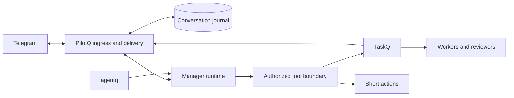

# PilotQ product contract

PilotQ is the conversational front end for work on a shared server. People discuss work in Telegram; PilotQ answers, performs bounded direct actions, or manages execution through TaskQ. A lost model connection must never silently lose an accepted request or authorize a repeated external action.

Date: 2026-10-22. Stage: specification. The name and repository are owner-approved; the owner made the repository public on 2026-10-22 so `main` rules apply (docs/bootstrap.md). The owner chose the base on 2026-10-22 (section 3). Requirements marked **Owner** come from the requested workflow. **Proposed** sections define a design to review and qualify, not shipped guarantees or permission to deploy.

Shared engineering, storage, security and release rules belong to [specq](https://github.com/taskqorg/specq/tree/main/engineering). Evidence: [research](docs/research.md), [mechanism matrix](docs/mechanism-matrix.md). Requirement checks: [acceptance](docs/acceptance.md).

## Specification hierarchy

The owner requires spec-driven work. `specq` is the shared base; this root contract contains only PilotQ-specific decisions and additions. For PilotQ, an explicit owner-approved decision or exception here takes priority over a conflicting shared default. Unmentioned areas inherit `specq`. An exception names the shared rule, scope and reason; an accidental conflict or an unapproved proposal is not an exception.

Supporting documents, README, instructions, tests and code follow this contract. They cannot introduce independent product decisions. Update the owning specification before implementing a changed decision. There are no approved shared-rule exceptions in this draft.

## 1. Outcomes and boundaries

**Owner requirements**

- **R1 Conversation:** run on a server, serve multiple authorized people through DMs, groups and forum topics, and preserve who said what and where.
- **R2 Direct help:** discuss, research briefly, answer, inspect a bounded resource and make a small authorized update without filing every request as a task.
- **R3 Management:** use TaskQ for most substantial work: clarify, plan, file, follow, answer status questions and relay worker questions and results.
- **R4 Flexible projects:** remember the usual project but allow a conversation to switch projects. Every external action must resolve a concrete authorized target.
- **R5 Reliability:** ordinary conversations and simple tasks work without repeated nudges. Restarts, timeouts and long context have explicit recoverable outcomes.
- **R6 Continuity:** preserve existing people, access roles, conversation boundaries and project associations during a later Hermes migration.
- **R7 Context:** support effective agentq integration, including original-data recovery and a measured quality baseline.
- **R8 Visibility:** provide task URLs, current state, attempt evidence and outcomes through existing TaskQ facilities.
- **R9 Model access:** use Codex with existing subscription access only. Claude and separately billed model API access are out of scope. Do not fall back automatically to paid API credentials.
- **R10 People and admission:** remember distinct users in persistent, correctable profiles. Ignore a person until an authorized administrator explicitly grants access; group membership alone grants nothing. Support inspecting and correcting remembered information and changing or revoking access.
- **R11 Observable lifecycle:** make acceptance, progress, waiting, interruption, failure and completion understandable in Telegram. Cover recovery and operational edge cases in the specification and acceptance plan before implementation, rather than adding them only after incidents.
- **R12 Least effort:** build the simplest agent that serves TaskQ work. Reuse proven mechanisms from known projects and the shared TaskQ system instead of inventing new ones.
- **R13 Two front ends:** offer a command-line interface and a Telegram gateway over the same request, grant and audit path.
- **R14 Operated like our tools:** PilotQ is monitored, updates itself through releases and is developed spec-first through its own TaskQ board.
- **R15 Administration by request:** an authorized administrator can tell PilotQ to remember a person with given rights and to create or register projects.
- **R16 Keys:** tools can use credentials on an authorized person's behalf; the model never sees a credential value.
- **R17 Request audit and telemetry:** every request leaves one durable record of who asked, when, where, what was asked, what PilotQ did and the outcome, joined to CoreQ telemetry. The record answers later service investigations, a person's questions about their own history and PilotQ self-improvement analysis.

**Proposed scope for the first release**

One Linux host, one Telegram bot, one manager runtime, existing TaskQ boards and explicitly registered project roots. Text, replies, task links and inline decisions are core inputs. Detect voice, images and documents; preserve their identity and report unsupported input explicitly. Media interpretation enters the cutover scope if the Hermes inventory shows it is needed.

Recurring work stays with an existing scheduler or TaskQ capability. PilotQ has no worker scheduler, autonomous goal engine, reviewer, new task board or general plugin marketplace. Its local inbox schedules conversation handling and delivery only; TaskQ remains authoritative for execution.

## 2. User behavior

### Conversation identity

**Proposed:** store bot identity, chat ID, topic ID where present, sender ID, message ID, update ID, reply reference and input revision. Names are display labels, never authority. Unknown or anonymous senders cannot approve a mutation by impersonating an allowed user.

Use an explicit session policy per route. Migration preserves the inspected Hermes distinction: ordinary-group conversations were per user; forum-topic conversations were shared. Reconfirm the export before cutover. Shared topics preserve each message's author and never import private DM context. New routes default to isolated conversations until a shared policy is selected.

Whether the bot responds to every message, mentions or replies is route configuration. Preserve the current behavior through an explicit migration manifest. Quoted messages, files, issue text and other bots are source material; they cannot change roles or approve work.

### People and admission

**Owner:** users have separate remembered identities; their information can be corrected. Users without an explicit grant are ignored.

**Proposed enforcement:** key each person by stable Telegram user ID within the installation; username and display name are editable labels, never proof of identity. Check both the person's grant and the route policy before model admission or any command/callback, including recovery controls. An allowed group does not allow all its members. Unknown, revoked or unidentifiable senders receive no reply, acknowledgement, typing indicator or action. Their updates cause no model call, task submission or memory update and are excluded from shared model context. An authorized person's deliberate quotation may be processed as untrusted source material, never as the quoted person's authorization.

Persist only the minimal ignored-update disposition needed for deduplication and polling progress; it is not an accepted work request and contains no message body. Granting access later does not replay ignored messages. The newly allowed person can send a new request.

An authorized administrator can inspect a user's access and permitted profile fields, grant scoped access, change it or revoke it through Telegram. Accept an exact Telegram user ID or a verified sender reference; resolve ambiguous names before writing. Record the acting administrator, target ID and before/after grant. Admission to conversation does not automatically grant project mutations, TaskQ management or user administration. A Telegram group-admin badge does not confer PilotQ administration. Bootstrap the initial owner ID through protected installation configuration, never through the first incoming message. Model output, remembered job titles and self-declarations cannot grant rights.

### Discuss, act, delegate

**Proposed:** discussion never implies execution. A direct request such as “check the disk space” already authorizes that bounded check. “Let's plan” produces a revisable proposal. “Run this plan” binds authorization to the displayed plan revision, target and scope; it does not require another ritual confirmation.

Direct work must satisfy all of these conditions:

- One clear authorized target and a bounded result.
- No need to survive as a long-running job, produce a reviewed implementation, or coordinate dependencies.
- A read-only operation or a small mutation with an explicit grant and a verifiable outcome.
- Execution fits the short-action budget in section 7.

Examples: inspect one service, read a bounded log interval, look up a ticket or explain an error. The only direct writes are the owner's board comments and labels ([section 5](#direct-actions-keys-and-project-switching)). A fast action can still be consequential: deployment, money, permissions or deletion do not become direct-safe because they take seconds.

Multi-file implementation, long research, broad audits, repeated experiments, deployment work and uncertain-duration work go to TaskQ. On reaching a direct-action budget, preserve observations and completed effects; propose the remaining task. Reuse existing authorization if it covers the delegation. Never describe a task as created until board readback identifies it.

When acting as TaskQ PM, PilotQ does not perform queued task work or answer on the owner's behalf. Its short-action role is separate from that PM role. This preserves the [TaskQ role contract](https://github.com/taskqorg/taskq/blob/93b499cf562167e380793c0c8fb15562407c6900/taskq.md).

### Changing direction

Persist follow-up messages immediately. Serialize model turns and compaction within a conversation; other conversations continue independently. New input can wait, steer at a supported safe point, or stop the current short action. Do not silently discard an earlier request when a new message arrives.

Plain-language controls are primary. Deterministic `/status`, `/stop` and `/new` are recovery controls that remain available when the model is unavailable. `/new` resets the model conversation, not task links, authorization records or active TaskQ work.

“Stop” must resolve its scope. Stopping the manager turn, parking a task and pausing new queue admission are different actions. A queue pause must not be reported as stopping an active worker. Use supported TaskQ transitions and verify their result; explain partial or pending termination.

## 3. Architecture and ownership

**Owner decision 2026-10-22 (option A):** PilotQ is one small Rust service in the TaskQ tool family.

| Part | Choice | Reason |
|---|---|---|
| Language and packaging | Rust single binary on [coreq](https://github.com/taskqorg/coreq) | Same release, update, service, status, selftest and incident path as taskq, agentq and dashq (R14) |
| Telegram | [teloxide](https://github.com/teloxide/teloxide) for the Bot API only | Maintained Rust library; PilotQ keeps its own durable ingress and outbox (section 4) |
| Telegram behavior | Patterns adapted from the Hermes gateway: update intake, delivery retry, stall watch, topic routing | Already exercised on our server (R12); read as reference, no change to Hermes |
| Manager runtime | Codex `app-server` under the subscription login, one adapter | R9; [core options](docs/core-options.md) |
| Journal | SQLite (section 7 settings) | One local file, supported snapshot backup |
| Work execution | Existing TaskQ CLI | Section 5 |

Grammy, Pi and a new runtime framework are out of scope. Earlier source findings remain in [research](docs/research.md).

| State | Authority | PilotQ responsibility |
|---|---|---|
| Received inputs, response delivery, route policy, grants and request correlation | PilotQ journal | Commit, deduplicate, restore and expose failures |
| Model conversation and summaries | Runtime session, backed by recoverable PilotQ input and finalized-output records | Preserve session identity; rebuild explicitly if native state is unusable |
| Plans being discussed | Versioned PilotQ proposal | Track target, author and authorization scope |
| Admitted task state, attempts, questions, dependencies and completion | TaskQ trusted board log | Read and invoke supported commands; cache only with source time |
| Project roots and worker capacity | TaskQ registration and host policy | Use registered entries; register a new project only on an administrator request (section 5); no directory discovery or silent enrollment |
| Compressed tool output and recovery reference | agentq adapter plus retained original evidence | Preserve access scope and validate recovered content |

Keep the runtime interface small: open/resume by ID, submit, stream events, interrupt, observe terminal result and close. Implement one adapter first. Do not build a universal runtime framework or expose native runtime tools that bypass the authorization boundary.

The manager uses a neutral explicit workspace. Project context is resolved through the approved registry and scoped tools, avoiding a process-wide current-directory switch shared by conversations. Separate runtime processes are fault boundaries; OS permissions and mounts enforce actual resource isolation.

## 4. Durable conversation and effects

**Proposed invariant:** every durably accepted request is queryable as queued, running, waiting for a person, delegated, answered, failed, cancelled or uncertain. Completion and Telegram delivery are separate fields. No persistent state is inferred from a typing indicator or model prose.

### Ingress

Use long polling initially. Commit admitted inputs, minimal ignored-update dispositions, deduplication keys and the next polling cursor in one SQLite transaction before making a Telegram request that confirms those updates. A handler cannot advance the cursor past an uncommitted disposition. A duplicate admitted update produces the existing request, not a second turn or task; ignored updates remain ignored.

Use one OS-held polling lock per bot installation; PID text alone is insufficient. The supported deployment is one host per token. A Telegram conflict from a second host is an incident, not an endless retry loop. Deployment explicitly stops the old consumer before activating a new one.

Treat update IDs as protocol identifiers, not proof of uninterrupted human history. Telegram retains undelivered updates for at most 24 hours; after a longer outage report the possible gap. Do not claim that a new bot can fetch all old group history.

Edited messages create a revision. They can revise an unstarted proposal; they cannot silently alter already authorized work. If work started, present the edit as a change request. A deleted input does not revoke an already executed side effect.

### Runs and tools

Persist request and run identity before invoking a runtime. Require a native terminal outcome; a closed stream or an empty response is not success. A generation/fencing token prevents a replaced or aborted runtime from emitting new authorized tool calls or final replies.

Persist the intent and stable operation ID before each external effect; persist its outcome and readback after it. A crash can occur between these steps. Recovery rules are:

| Interrupted operation | Recovery |
|---|---|
| Pure model generation or bounded read | Retry within budget; distinguish regenerated text from the original |
| TaskQ mutation | Reconcile the same operation ID and revision against TaskQ |
| Direct idempotent mutation | Read back the target, then retry only under its declared idempotency contract |
| Non-idempotent or unobservable external effect | Mark uncertain, block automatic replay and request a decision |
| Completed result with pending Telegram delivery | Retry delivery; do not rerun the agent or tools |

SQLite records are the durable acceptance boundary. Pi's native JSONL session is not sufficient evidence of power-loss durability or atomic external effects. Preserve a recoverable transcript projection and tool receipts before acknowledging completion. Rebuilding a damaged native session must not replay previous mutations.

### Delivery

Commit final replies, worker questions and results to an outbox with immutable destination and correlation ID. Preserve per-conversation order; coalesce superseded progress updates only. Keep terminal outcomes and unanswered questions.

Record Telegram message IDs after successful sends; update a known status message when useful. Telegram `sendMessage` has no general client idempotency key: after a lost send response, a duplicate visible reply is possible. Report an ambiguous send as such and use bounded at-least-once delivery for results. Never repeat task execution to solve a delivery problem.

Formatting errors fall back to plain text. Split oversized replies safely; do not rerun generation. Respect server retry delays, bound retry counts and retain exhausted deliveries for operator recovery. Forbidden or missing-chat errors must not reroute private results to a broader group or silently mark them delivered.

## 5. TaskQ integration

**Proposed:** wrap the supported CLI with argument arrays and typed validation; no shell interpolation of Telegram text. Use its JSON status and existing task log facilities. Do not create a new public TaskQ API before evidence shows the CLI cannot support the required flow.

- Read: registered projects, fresh status, task details, current question and attempt evidence.
- Write: create a held task, start it, answer the current question, steer, requeue or park within the user's scope.
- Exclude from ordinary manager tools: host grants, capacity changes, arbitrary closure/publication and forced cleanup. Expose a privileged operation only when separately granted and verified.
- Resolve ticket links to an allowed board and project. A number such as `#12` alone is insufficient when it can match several boards.
- Preserve the real Telegram author, originating route, request ID and approval revision in the audit trail. A bot credential does not turn every user into the repository owner.
- `add --op-id` requires `create_claim_issue` and a qualified board readback path. Disable creation when this prerequisite is absent. Plain `add` is not a safe retry fallback.
- Bind answers to board, task, attempt, question revision and authorized answerer. Stale buttons or a forwarded approval are rejected with the current question.
- Start a multi-ticket plan only after every planned ticket reads back. Partial creation stays held and visible; use stable child operation IDs when continuing it.
- Preserve TaskQ's distinction between admission, worker result, reviewer result, owner gate and publication. “Done” requires the authoritative completion state and available evidence.
- Notifications are projections of TaskQ events, keyed by board/task/event/route. Reconcile after downtime; do not let stale status overwrite a newer question or outcome.

### First TaskQ tool contract

**Owner-scoped (tasks #18 and #39):** every explicitly registered project, through the TaskQ CLI on the PilotQ host. TaskQ mutations on these boards are separate from the owner-only direct issue writes below.

- Configuration: `config.json` `taskq` names the CLI binary and the project root. PilotQ runs it with an argument array, `TASKQ_ROOT` set to that root and no `TASKQ_ATTEMPT`. The configured root seeds the initial `pilotq` registry entry only when its `taskq.json` names `taskqorg/pilotq`; it never replaces a registered entry. Each call uses the resolved registered root, checks its `taskq.json` against the registered board and requires a fresh complete snapshot naming that board before board writes or task reads. An unavailable snapshot leaves an authorized plan unsent for retry. A mismatch disables that target.
- Project scope is `project:<registered-name>`, or `projects` for an administrator. The owner holds `projects` from protected configuration.
- The manager gets these tools as Codex dynamic tools. Each one is checked at dispatch against the caller's current grants and the run's fence. A refusal writes nothing and says why.

| Tool | Grants | Effect |
|---|---|---|
| `task_plan` | project scope | Saves the conversation's next plan revision: one to three tickets, each a title, goal, acceptance and scope. No board write |
| `task_run_plan` | `taskq` and project scope | Files every ticket of the named revision held, reads each back, then starts them |
| `task_status` | project scope | Fresh board read of one task by number or a registered board issue URL. Never creates |
| `task_park` | `taskq` and project scope | `later` with the person's reason; the worker's own lifecycle stays TaskQ's |
| `task_steer` | `taskq` and project scope | Sends 1–4 instruction lines to a task currently doing, fenced to its fresh TaskQ revision; returns the receipt and task URL |
| `task_requeue` | `taskq` and project scope | Requeues one open task with the person's reason, fenced to its fresh TaskQ revision; returns the receipt and task URL without claiming worker termination |
| `queue_pause` | `queue` | `taskq service pause`: stops new admission on the host. Running workers continue and are listed as running |

- Plan, run, status, park, steer and requeue use the Target rules below and accept an optional `project`. A plan binds its project, board and root when saved; running it cannot retarget it, even after a conversation switch. A changed registration refuses further submission. A plan without a task reference resolves the current or sole accessible project; ambiguity lists accessible names.
- Subscriptions, status edits, question replies and audit events preserve project and board identity as well as task number. Two boards' `#19` tasks never share state. Answers use the originating subscription, not the conversation's current project, and recheck the fresh question revision and current project grant before writing.
- Park, steer and requeue persist their exact intent and stable operation ID before dispatch. Recovery reconciles that same ID and revision, never a new mutation. Uncertain readback remains visible. Refusals name the reason and write no board state. Text is validated against TaskQ limits, never silently shortened.
- `task_run_plan` runs only the latest revision, saved by an earlier request of the same conversation. A revision saved in the same request is refused, so a plan-only request starts nothing. One revision runs at most once.
- Creation uses `add --op-id` only, never plain `add`. It needs `create_claim_issue` in the root's `taskq.json`; without it creation is disabled with that reason. Op IDs are `pilotq-<installation>-p<plan>-t<ticket>`, and `.start` for the start. Each ticket body carries one scope line with the request trace ID, the Telegram author, the route and the plan revision.
- Start follows only after every ticket of the revision reads back held. An unavailable board leaves the remaining tickets unsent with the reason. The periodic scan retries the same op IDs until every ticket is held and started; changed grants are rechecked before each retry.
- The manager never answers a worker question. PilotQ relays the question to the originating route; a person answers by replying to that message. The answer binds to task, question revision and the replying person: it needs `taskq` and project scope, and the task must still be in `ask` at that revision on a fresh read. A stale or foreign answer writes nothing and replies with the current question or the missing grant. A written answer uses `answer --op-id --revision`.
- Each filed task has one status message in its originating route, edited in place on each fresh transition and naming what it waits for. A question and the closing outcome are separate messages; nothing edits them. A projection older than the stored task revision is ignored.
- A periodic scan of `taskq status --json` recovers missed transitions; restart and `/new` keep subscriptions. An incomplete snapshot reads unknown and closes nothing.
- **Owner, 2026-10-23:** the live evidence for this step is a scripted run, not a person on the test bot. It uses the real PilotQ binary, real Codex under PilotQ's subscription login, the `taskqorg/pilotq` board and the TaskQ CLI. A local fake Bot API replaces Telegram, with updates from two synthetic users, and records every send. One small real docs task goes from discussion to the reviewer outcome with a PilotQ restart mid-run. The run checks the journal, audit record, board and recorded messages, U23 links included. A later owner check on the test bot is optional.

### Direct actions, keys and project switching

**Owner decision 2026-10-23 (option B, task #23, section 10 step 4):** direct actions are reads. Only the owner (`owner_id` from protected configuration) may write directly, and only a comment or a label on an issue of the `taskqorg/pilotq` board; there are no other direct writes. Keys enter only through the CLI.

The manager gets these tools beside the TaskQ tools, checked at dispatch like them:

| Tool | Grants | Effect |
|---|---|---|
| `project_use` | project scope | Sets the conversation's current project. The project must be registered and named in the person's own message |
| `issue_read` | project scope and a key granted for the tool | Reads one issue of a registered project: title, state, labels, a bounded body excerpt, the issue's update time (source time) and the read time |
| `issue_comment` | owner, a key | Adds one comment to a `taskqorg/pilotq` issue |
| `issue_label` | owner, a key | Adds one label to a `taskqorg/pilotq` issue |

- Target: a tool resolves one registered project from an explicit `project` argument, an issue URL or the conversation's current project. An explicit project or URL must be named in the person's own message or be the current project; quoted messages, issue text and tool output never select one. A bare number with no current project and several accessible projects is refused with the list, never guessed. Another project stays read-only.
- Budget: one request makes at most 5 PilotQ tool calls within the section 7 direct-action deadline. The sixth call is refused and writes nothing. A request that ends at its deadline replies with the evidence it kept, and the rest can become a planned task.
- Effects: a comment or label persists its intent and operation ID `pilotq-<installation>-r<request>-e<n>` before the write, and its receipt after a readback. A comment carries its operation ID as a hidden marker. After a crash between write and receipt, startup reads the target back: found means written once; absent means not written. Neither is repeated automatically, and the route is told. A readback that fails leaves the effect uncertain.
- Revoking a project or key grant refuses every later call; a completed effect stays recorded.

### Project registration

An administrator with the `projects` grant can ask PilotQ to create or register a project. PilotQ shows the resolved repository, root and board, then applies the request through TaskQ's supported registration path (Add project, [taskq.md](https://github.com/taskqorg/taskq/blob/main/taskq.md) menu M10) and reads it back. Repository creation, capacity and worker grants stay owner operations unless a separate grant names them. A failed or partial registration stays visible and is never reported as done.

Step 4 registers through the CLI: `pilotq projects add NAME ROOT` accepts a root whose `taskq.json` names a repository only when a fresh `taskq status --json` under that root reads back the same board, and records who registered it. TaskQ's Add project conversation stays the owner's way to create the TaskQ side.

An operations board is an explicit server-care project. Project work stays on that project's board. A server-wide overview aggregates tasks; it does not duplicate every issue onto a server board.

TaskQ execution continues when PilotQ is down. If TaskQ is unreachable, conversations continue and proposed tasks remain unsent. Status shows the last observation time and unknown freshness. Previously authorized, unchanged submissions can resume when dependencies recover; changed scope or stale grants require revalidation.

## 6. Memory and agentq

**Proposed:** conversation history, remembered preferences and authoritative task facts are distinct. Store route/project preferences with author, scope, source and update time. “Usually this project” is a hint; tool invocation still resolves the target. Explicit corrections supersede old preferences. Shared memory never includes private conversation content without authorization.

Maintain durable per-person profiles for preferred name, relevant working preferences and explicitly remembered project associations. Each fact carries its subject user ID, visibility scope, source and revision. Load only facts permitted in the current route; remembering one person across chats does not copy private DM history into a group. Profiles survive restart and conversation reset.

Provide a Telegram flow to inspect, correct and forget remembered facts. Users can manage their own non-authoritative preferences; administrators can correct shared profile information within their grant. Administration does not implicitly reveal another person's private DM memory. Show the applied change and persist it before claiming success. Corrected or forgotten facts must not reappear as current facts from an old summary, restored session or automatic extraction. Profile deletion and correction are distinct from retention of conversation/audit records; do not claim that forgetting a preference erases every historical record. Access rights live in the grant registry and cannot be changed by editing a profile.

Keep these outside lossy summaries: identities and roles, grants and revocations, active project references, request/operation IDs, task URLs, pending questions, plan revisions, explicit prohibitions and verified effect receipts. Fresh TaskQ reads supply task state.

Start with native runtime compaction as the functional baseline. Integrate agentq at the selected runtime's supported tool-result/context boundary. Tool-result compression and conversation summarization are separate stages with one owner each; never let two compactors race or compress the same result repeatedly.

Compression preserves tool-call/result associations, errors, evidence locations and original-data recovery references. Recovery authorizes the requesting route before returning content. On compression failure, use original data only if it fits the context budget; otherwise fetch a bounded relevant portion or surface a context limit. Never silently truncate authorization or replay work to reconstruct a missing result.

Qualification compares identical scenario sets with agentq off and on. Measure correct completion, preserved constraints, exact original recovery, provider input/output/cache tokens where available, latency and interventions. Byte reduction alone is not a savings claim. A session that survives one compression is not evidence of a long conversation remaining correct.

## 7. Proposed operating budgets

These are initial acceptance targets, not observed performance or a production SLA. Tune only from recorded pilot evidence.

| Concern | Initial target |
|---|---|
| Durable receipt | p95 <= 2 seconds from update receipt at PilotQ, under the defined pilot load |
| Telegram acknowledgement | p95 <= 5 seconds when Telegram is reachable; can be omitted if a complete answer arrives sooner |
| Direct action | <= 60 seconds and <= 5 tool calls; longer work is delegated or returned with a bounded result |
| Silent runtime | No useful event for 30 seconds triggers diagnosis; runtime deadline still applies even if it emits tokens indefinitely |
| Cancellation | Acknowledge within 5 seconds when transport is healthy; abort then terminate the isolated process after a 5-second grace period if necessary |
| Runtime recovery | Reconcile interrupted requests within 30 seconds after service readiness; uncertain effects stay blocked |
| Model concurrency | 4 conversations initially, one active run per conversation; round-robin waiting routes |
| Backlog | 50 pending requests per route, 1,000 total; excess gets a recorded busy response, never an untracked promise |
| Dependency retry | At most 3 safe model/read attempts within the original deadline; no retry multiplication across SDK and coordinator |
| Delivery retry | At most 5 attempts per episode, persisted across restart; obey Telegram retry delays, then surface pending delivery |
| Task notifications | Within 15 seconds of observing a fresh TaskQ transition, while Telegram is reachable |
| Health | Separate last successful poll, storage commit, model event, TaskQ observation and delivery; expose age and unknown state |

Storage: SQLite WAL with `synchronous=FULL`, one writer, local disk and bounded transactions. A healthy process is not evidence of a healthy ingress path. Run liveness checks outside the model process; use the existing host monitoring path for an outage that prevents Telegram alerts.

Proposed retention: raw conversations 30 days; request audit records (section 8) 365 days for metadata and 90 days for message text; inactive native session files 30 days; request/effect receipts 90 days after reconciliation; diagnostic logs 7 days; temporary attachments 7 days with a 20 MiB per-file cap. Keep active plans, unresolved effects, unanswered questions and undelivered outcomes until resolved. Keep minimal deduplication/receipt tombstones beyond content pruning where replay remains possible.

Initial PilotQ disk budget: 2 GiB including its journals, sessions and temporary files. At 80%, prune only eligible data and alert. At the hard limit, preserve unresolved records, stop new admission and report pressure through the host channel. Do not advance the Telegram cursor for an input that could not be stored. This limit can cause a Telegram retention gap during a prolonged outage; report it. Back up with SQLite's supported snapshot mechanism; prove restoration separately.

## 8. Access and observability

**Proposed:** configure explicit Telegram users/routes and action grants. Reading a group or a task does not grant permission to mutate a project. Revalidate authorization at effect dispatch and before delayed delivery. Revocation cancels pending unauthorized effects but cannot erase an already completed operation.

Keep credentials in protected host configuration, outside model context and diagnostics. The manager receives only tools granted to its caller and route.

### Key store

**Proposed:** a key is a named secret in one owner-only file under the install directory (mode 0600 or the Windows equivalent). Each key records its name, purpose, allowed tools, allowed users or routes and last use; the value is stored once and never returned.

- A tool call names a key; the tool boundary injects the value into the child process environment or request header at dispatch.
- The value never enters model context, the journal, telemetry, logs, replies or task text. Tool output is scrubbed for known values before the model or Telegram sees it.
- A grant on a key names the person, route or project. Use is checked at dispatch, like any effect (section 8).
- Keys are added, granted and revoked only through the CLI (owner decision 2026-10-23). Telegram key entry is not built.
- `pilotq keys list` shows names, grants and last use, never values. A model's tool choice is a request, not enforcement. Downloaded content cannot expand grants, switch repositories or redirect private answers.

### Request audit

**Proposed:** the journal keeps one audit record per request from the CLI or Telegram (R17). It is written in the same transaction as the admitted input and updated as the request moves.

- Who: person ID, display name at that time and the grant set used. When: receive, start, each effect and delivery times. Where: front end, chat, topic and project.
- What: the request text, its edits and cancellations, and the reply sent. Key values never appear (section 8 Key store).
- Done: model, version and agentq mode; each tool call and effect with its target and result; TaskQ tasks filed, answered or followed; the final outcome or failure.
- One request ID joins the audit record, the CoreQ telemetry trace and TaskQ task text, so an investigation can move from a Telegram message to a task attempt and back.
- Readers: the owner and administrators with an `audit` grant read all records through `pilotq audit`; every person can read their own with `/audit` in a direct message, answered without the model like the section 2 controls. In a group or topic `/audit` shows nothing, since it would expose one person's history to the others. Reading is itself recorded.
- Use: service investigation, answers to a person about their history, and self-improvement analysis. Analysis exports leave out message text unless the owner approves a specific export.
- The person learns at admission that their requests are recorded and for how long.

Local correlated events cover update → request → model turn → tool operation → TaskQ task/attempt → Telegram delivery. The runtime adapter reports actual completion/error events. Model/provider/version and agentq mode accompany evaluation evidence.

Use the existing Langfuse installation for optional, bounded telemetry export after capture scope is approved. Content capture is opt-in and redacted; operational metadata is enough for delivery and intervention metrics. Langfuse failure must not block conversations or become the only copy of a task outcome. The proposed metric set lives in [acceptance](docs/acceptance.md#metrics).

## 9. Command line, update and monitoring

### Command line

**Proposed:** the `pilotq` binary is the service and the operator CLI. The CLI uses the same journal, grants and audit records as Telegram; the local operator acts as the bootstrap owner identity from protected configuration.

| Command | Purpose |
|---|---|
| `pilotq ask TEXT [--project P]` | One request through the normal manager path; prints the reply or task link |
| `pilotq status [--json]` | Health ages (section 7), pending requests, undelivered outcomes, uncertain effects |
| `pilotq users list\|show\|grant\|revoke\|remember\|forget` | People, profiles and grants (R10, R15); `remember`/`forget` correct one profile fact |
| `pilotq routes list\|set` | Chats, topics and their session and reply policy |
| `pilotq projects list\|add` | Registered projects and the section 5 registration path |
| `pilotq keys list\|add\|grant\|revoke` | Key store; `add` reads the value from stdin |
| `pilotq pilot start\|note\|report [--since T] [--json]` | Seven-day pilot start, intervention and outage notes, gate 4 counts (section 10 step 5) |
| `pilotq audit [--user U] [--route R] [--project P] [--since T] [--request ID] [--json]` | Request audit records (section 8, R17), filtered by who, where, what and when |
| `pilotq service install\|run\|stop\|status` | coreq service unit |
| `pilotq update [--check]`, `pilotq selftest`, `pilotq doctor` | coreq update, smoke test and setup check (bot identity, Codex login, TaskQ reachability) |

Every command that writes prints the readback, supports `--json` and returns a nonzero exit code on failure.

### Update and monitoring

Follow coreq: `releases/<version>`, `current` and `previous` in the install directory; GitHub releases with `SHA256SUMS`; `pilotq update` verifies the checksum and runs `pilotq selftest` before the switch; the launcher returns to `previous` after three unhealthy starts. An update waits for the planned-restart drain in section 12.

`status.json` publishes the section 7 health fields. Incident reports follow coreq. Telemetry uses the shared CoreQ telemetry store and DashQ connection, so the TaskQ PM sees PilotQ beside the other tools. Release and CI follow the shared [release contract](https://github.com/taskqorg/specq/blob/main/engineering/release-contract.md).

### Development

PilotQ has its own TaskQ board. Changes follow the TaskQ flow: spec edit first, held task, worker, reviewer, release.

## 10. Adoption sequence

1. Review this contract and cases. Decide the direct-action grants, media parity, runtime/provider credentials and deployment budgets before implementing affected behavior.
2. **First slice:** coreq skeleton with `service`, `update`, `selftest`, `status`; separate test bot; journal with durable ingress and outbox; `pilotq ask` and Telegram DM, ordinary group and forum topic; admission and grants with `users`; per-person profile memory; Codex answer; request audit records and CoreQ telemetry from the first request. Qualify duplicate input, timeout, crash, an update during a turn and two-route isolation before adding features.
3. Add one TaskQ project: discuss → authorize → held create/readback → start → status → worker question → answer → reviewer outcome. Restart PilotQ during execution.
4. Add the key store, small direct actions, project registration and flexible project switching, with the same effect receipts and authorization checks.
5. Run the complete route/role matrix and start the seven-day pilot on the native compaction baseline. **Owner, 2026-10-23 (task #26):** agentq 0.9.0 compresses only Codex shell results and PilotQ disables the shell tool, so agentq cannot change PilotQ context yet. C01–C07 run live with agentq off; agentq-on runs are recorded as not run with that reason. agentq qualification follows the agentq dynamic-tool adapter ([taskqorg/agentq#167](https://github.com/taskqorg/agentq/issues/167)) and enables agentq only if the P1 metric gate passes. `pilotq pilot start` records the pilot start, `pilotq pilot note intervention|outage TEXT` records a manual intervention or a provider outage, and `pilotq pilot report` prints the [gate 4](docs/acceptance.md#selection-gates) counts from the journal and telemetry.
6. Prepare migration inventory, restore proof and rollback. Switch production only after the acceptance gates pass and deployment is authorized.

Migration imports a reviewed manifest of route policies, roles, projects and user-approved memories. Credentials transfer through protected configuration. Inspect existing Hermes goals and scheduled jobs one by one; resume, retire or migrate explicitly to avoid two systems performing the same work. Link old task evidence rather than copying execution claims into a model summary.

For a later same-token cutover, stop and verify the old poller before enabling PilotQ. Keep a handoff cursor and identify any old in-flight inputs. Native Hermes history may need a bounded reviewed summary plus archived references, not blind transcript conversion. Rollback drains or preserves PilotQ's accepted inputs and outbox, stops its poller and restores Hermes's consumer. TaskQ tasks already admitted remain authoritative and are not resubmitted.

## 11. Decisions still open

- Codex account and subscription entitlement for a shared server deployment.
- Required voice/image/document behavior for Hermes cutover.
- Final retention/capacity thresholds and permitted telemetry content, including the proposed audit retention (365 days metadata, 90 days message text).

Closed 2026-10-23 (owner, option B): short-action grants and Telegram key entry. Direct actions are reads per grant, the owner alone comments on and labels board issues, nothing else is written directly, and keys enter only through the CLI ([section 5](#direct-actions-keys-and-project-switching)).

## 12. Proposed lifecycle and feedback protocol

This section translates R5 and R11 into a proposed PilotQ protocol. The [mechanism matrix](docs/mechanism-matrix.md) records source evidence and scope choices; [acceptance](docs/acceptance.md#lifecycle-cases) defines the additional checks. These are design targets, not implemented guarantees. Notification presentation follows [specq](https://github.com/taskqorg/specq/blob/main/caveman/rules/notifications.md).

### One request, separate observations

Keep the request state from section 4; use a reason/phase field for queued capacity, model startup, tool execution, compaction, provider backoff, quota exhaustion or required login. Do not introduce a second task state machine. Waiting for a person or for TaskQ is not a hung manager run. A delegated request remains linked to the authoritative TaskQ task and its notification subscription.

Track transport health, request activity and delivery separately. A successful empty poll proves transport contact; it does not prove received inputs reached admission. A live process or typing indicator proves neither useful progress nor task completion. Count accepted/dispatched inputs and pending age as well as successful polls. Unknown observation remains unknown.

The runtime supervisor observes startup/first-event latency, last useful runtime/tool event and the absolute run deadline. The first-event watch starts before invoking Codex; it cannot depend on Codex having emitted its first event. Typing, polling and periodic status timers never renew useful-progress time. Token activity cannot extend the absolute short-action budget. Waiting states retain their reason and wake condition without busy retries. Use monotonic time within a process; persist deadlines/attempts across restart and handle wall-clock jumps without granting a fresh unlimited budget.

### Telegram feedback

| Event | User-visible behavior | Source of truth |
|---|---|---|
| Request committed | Acknowledge within section 7's budget, unless the final reply arrives sooner; identify queueing if work has not started | Journal commit and queue state |
| Codex active | Best-effort typing in the exact originating topic; optional short status such as checking or reading | Current run and factual events |
| Meaningful progress | Update one correlated status message; describe an observed milestone without raw tool arguments, hidden reasoning or invented percentages | Completed tool result or fresh TaskQ transition |
| Waiting | State what is needed: user answer, capacity, provider reset or sign-in; retain the request | Persisted reason and dependency evidence |
| Stall or failure | State the affected request, what is known and the next available action; notify once per incident episode | Supervisor and receipts |
| Recovery | Notify only after a fresh successful observation; distinguish connection recovery from completion of the original work | Verified dependency/run observation |
| Stop requested | Acknowledge the request; claim stopped only after termination or fencing is verified; show uncertain effects separately | Supervisor plus effect reconciliation |
| Delegation | Return the verified TaskQ URL; further questions/results follow TaskQ state | Board readback |
| Answer or outcome ready | Persist the final content and delivery obligation together, then send; show failure/partial outcome honestly | Journal, native terminal event and target evidence |

Proposed presentation defaults: refresh typing at most every 4 seconds while the current run is active and within the 30-second first-event/activity window; stop refresh on stale activity, cancellation, terminal state or waiting. A typing failure cannot block work. Progress edits are coalesced and limited to one per 2 seconds per route, subject to stricter Telegram limits. No periodic model calls generate reassurance. These are initial limits to qualify, not observed responsiveness.

An outbound projection carries request ID, run generation and event revision. A delayed progress edit cannot overwrite a newer status or final answer. Final results, unanswered questions and actionable failures outrank cosmetic edits; delivery scheduling still preserves required per-request order. Persist long final answers as stable ordered chunks with individual receipts, so recovery does not regenerate or blindly resend every part. A missing/deleted status message permits a new status message in the same authorized route, without rerunning work. Telegram ambiguity and duplicate delivery remain bounded by section 4.

### Input and control edges

During startup, check bot identity, required Telegram permissions/privacy configuration and forum-topic support against the migration manifest. Do not report readiness solely from login success. Received but unsupported inputs get the explicit outcome in section 1; unknown senders still follow R10's silent policy.

Preserve message/reply IDs, edits and media-group identities before optional batching. Never coalesce messages across users, routes or authorization revisions. A bounded media assembly window cannot swallow a text follow-up or change a running plan. Recognizing attachments and reporting limits are required; interpreting every media type remains an open cutover decision.

Authorized `/status`, `/stop` and `/new` use a bounded control path outside the normal model backlog. They do not bypass identity or scope checks. A reset creates a new conversation generation; old requests and receipts remain queryable, and late old-run events cannot attach to the new conversation. Reset does not revoke the originating subscriptions to already admitted TaskQ work.

Topic deletion/closure, group migration, bot removal and permission loss become explicit delivery/configuration incidents. Preserve the original destination and hold affected output. An administrator must authorize a route change; do not fall back to General, a private DM or another group automatically.

### Runtime and recovery boundaries

Validate the pinned Codex protocol/capabilities before accepting executable work. Unknown optional diagnostic events can be retained as metadata; unknown control/terminal semantics cannot be guessed as success. Parse tools only after a complete validated request; a parseable partial argument stream is not permission to act. Disable or contain native tools that bypass PilotQ's effect boundary. An empty useful answer with no verified delegation/action is an explicit outcome to recover or report, not silent success.

Classify auth, quota, transport, protocol and tool failures. Keep one bounded retry budget per logical operation across layers/restarts; honor server retry times without holding conversation locks or spinning. Persist account/workspace binding with the native session. Reauthentication must not silently change that binding, discard the session or fall back to billed API access. The shared deployment's subscription entitlement remains a separate pre-production qualification.

Use one journal reconciler at startup and on a bounded periodic scan to discover pending inputs, stale runs, uncertain effects, missed TaskQ events and undelivered outcomes. Timers are wakeups, never the sole copy of work. Reconcile one request at a time; a failing route cannot stop recovery for the others. Keep external calls outside database transactions.

On planned restart/update, stop new execution, checkpoint/drain within a bounded grace period, fence and terminate remaining manager process trees, and leave unresolved work in the journal. TaskQ workers retain their own lifecycle. Startup validates config and storage, obtains the poller lock, reconciles state and only then reports readiness. A crash-loop backoff prevents repeated startup from consuming retries or producing alert storms. An external host monitor handles a dead or blocked PilotQ process; PilotQ cannot promise a Telegram notice while both it and Telegram are unavailable.

Apply the shared [release/service contract](https://github.com/taskqorg/specq/blob/main/engineering/release-contract.md) to the selected Linux service and pinned Codex artifact. Before implementation, name the service owner, artifact/update source and compatible schema range. A rollback must preserve accepted work; an incompatible database prevents unsafe downgrade. No live runtime replacement occurs mid-turn without the drain/reconcile path.

This specification does not authorize installation, model calls, queue activation or replacement of the production Telegram consumer.
